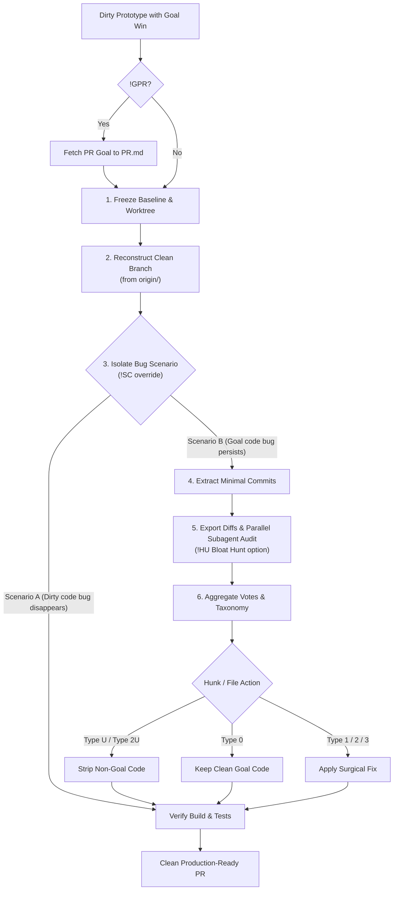

# Afterplay

Distill a dirty prototype branch that achieved a target goal into minimal, verified production commits using baseline isolation, per-file diff audits, and a 6-tier bug/relevance taxonomy.

- Subagent prompt templates, JSON schemas, and consensus report format: see [REFERENCE.md](REFERENCE.md).
- Helper script CLI flags and JSON manifest specs: see [SCRIPTGUIDE.md](SCRIPTGUIDE.md).

## Workflow



## Execution Phases

### Phase 1: Freeze Baseline & Goal
1. Tag the prototype commit (`git tag -a "dirty-code-<goal>-but-<symptom>" -m "dirty reference baseline"`).
2. Add a detached worktree (`git worktree add --detach ../<goal>-dirty-reference <dirty-prototype-branch>`) so it never collides with an active branch checkout.
3. If `!GPR<PR_ID/URL>` is supplied, run `node <skill-dir>/scripts/get-pr-description.js <PR_ID/URL> -o "<appDataDir>/brain/<conversation-id>/PR.md"` (or fall back to `gh pr view` / GitHub MCP) to set `PR.md` as the Goal spec.
4. Record quantitative baseline Goal metrics (latency, test pass rate, memory, or acceptance criteria).

### Phase 2: Reconstruct Clean Target Branch
Create a clean branch from `origin/<target-base-branch>`, tag it (`clean-code-<goal>-but-<symptom>`), and port only minimal abstractions from `../<goal>-dirty-reference`.

### Phase 3: Isolate Bug Scenario
- **Scenario A (Bug disappears on clean branch):** Defect came from dirty prototype wrappers. Discard dirty code and verify build/tests.
- **Scenario B (Bug persists on clean branch):** Defect is in core Goal changes. Proceed to Phases 4-6.

### Phase 4: Extract Minimal Implementation
Split prototype work into atomic commits (`feat:` vs. `test:`/dev-bypass) by soft-resetting to the base branch (`git reset --soft origin/<target-base-branch>`) and staging production vs. test files separately.

### Phase 5: Per-File Diff & Parallel Subagent Audit
1. Export per-file `.diff` files against `<base-commit-or-branch>`:
   ```sh
   node <skill-dir>/scripts/export-diffs.js <base-commit-or-branch> -o "<appDataDir>/brain/<conversation-id>" --update --json
   ```
   (Fallback if Node/script is unavailable: `git diff --name-only <base>` and `git diff <base> -- <file>`).
2. **Incremental Re-Audit (`--update --json`):** Only spawn subagents for entries with `"isUpdated": true`; reuse prior classifications and confidence scores for `"isUpdated": false`.
3. Spawn `N` subagents concurrently (1 `invoke_subagent` call per updated diff file in one turn). If `!HU` is active, use the Bloat Hunt prompt template from [REFERENCE.md](REFERENCE.md).
4. Provide each subagent: the `.diff` path, source file path, `PR.md` path (if present), Goal metrics, and bug symptoms. Instruct subagents to classify every Git Hunk (`@@ -L,N +L,M @@`), compute line-weighted percentages (`% Type X = (lines in Type X / total changed lines) * 100%`), and recommend a file action.

### Phase 6: Confidence Voting & Taxonomy
Aggregate subagent reports into `<appDataDir>/brain/<conversation-id>/subagents_diff_and_bug_analysis.md` using the schema in [REFERENCE.md](REFERENCE.md):

| Code | Name | Description | Action |
| :---: | :--- | :--- | :--- |
| **Type 0** | Clean / Clear | Contributes to Goal; unrelated to bug | **Keep** |
| **Type 1** | Missing Code | Bug caused by missing Goal logic | **Implement** |
| **Type 2** | Existing Code Bug | Bug in pre-existing code needed for Goal | **Surgical Fix** |
| **Type 3** | Both | Pre-existing defect + missing Goal code | **Implement + Surgical Fix** |
| **Type U** | Unrelated | Does not contribute to Goal (bloat/dead code) | **Strip / Discard** |
| **Type 2U** | Unrelated Bug | Bug in code unrelated to Goal | **Strip / Discard** (do NOT fix) |

File-level synthesis:
- **Full Discard:** `Type U + Type 2U > 80%` AND remaining hunks are not critical to Goal.
- **Partial Strip:** Revert `Type U` / `Type 2U` hunks while keeping `Type 0`.
- **Surgical Fix:** Apply minimal edits for `Type 1/2/3` hunks, then run build and tests.

## Failure Modes & Recovery

| Condition | Action |
| :--- | :--- |
| `scripts/get-pr-description.js` or `scripts/export-diffs.js` fails | Fall back to `gh pr view` / GitHub MCP for PR text, and `git diff --name-only` + `git diff <base> -- <file>` for per-file diffs. |
| `git worktree add` fails because branch is checked out | Use `git worktree add --detach` or pass the tagged commit SHA. |
| `Type U + Type 2U > 80%` file still has a critical Goal hunk | Downgrade from **Full Discard** to **Partial Strip** and preserve the Goal hunk. |
| Subagents return conflicting classifications for a file | Re-run a tie-breaker subagent with both prior assessments or inspect the hunk directly before editing. |
| `Partial Strip` or `Surgical Fix` breaks build or tests | Revert the last hunk change (`git checkout -- <file>` or `patchitright`), re-check cross-file pointers, and re-verify. |

## Domain Terms and Tag Commands

- **`Goal`**: Target feature, bugfix, or performance win achieved on the prototype branch.
- **`Scenario A` / `Scenario B`**: Dirty-wrapper bug (disappears on clean branch) vs. core-goal bug (persists on clean branch).
- **`!SC<A|B>` (Scenario Choice)**: Forces Scenario A or B in Phase 3 without empirical branch isolation (Default: auto-detect; Timing: Start-time).
- **`!HU` (Hunt Unrelated)**: Restricts Phase 5 subagents to a fast pass identifying `Type U` / `Type 2U` diffs to strip first (Timing: Start-time / Mid-flight).
- **`!GPR<PR_ID/URL>` (Get PR Goal)**: Fetches PR description to `<appDataDir>/brain/<conversation-id>/PR.md` as the Goal spec for Phase 1 and Phase 5 subagents (Timing: Start-time).
