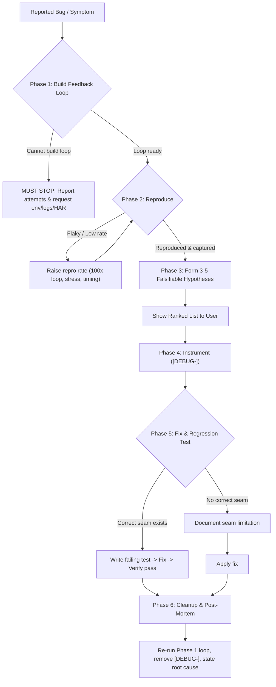

# Diagnose

Run a 6-phase diagnosis loop for hard bugs and performance regressions. Skip phases only when explicitly justified. If the repository includes a domain glossary or ADRs for the affected area, read them first.

## Workflow

## Phase 1: Build a Feedback Loop

Construct a fast, deterministic, pass/fail signal before forming hypotheses. Try options in roughly this order:

1. **Failing test** (unit, integration, or e2e) reaching the target seam.
2. **HTTP / CLI script** against a running server or fixture input (diffing stdout).
3. **Headless browser script** asserting on DOM, console, or network.
4. **Trace replay** of a captured request, payload, or event log in isolation.
5. **Minimal throwaway harness** exercising the target path with mocked dependencies.
6. **Property / fuzz loop** (e.g., 1000 random inputs) for intermittent wrong outputs.
7. **Bisection harness** (`git bisect run`) when regression bounds are known.
8. **Differential loop** comparing old vs. new versions or two configs on identical input.
9. **HITL script** (`<skill-dir>/scripts/hitl-loop.template.sh` on POSIX shells) if manual UI clicks are unavoidable.

Refine the loop for speed (skip unrelated init), signal sharpness (assert the exact symptom, not "no crash"), and determinism (pin time, seed RNG, isolate filesystem, freeze network). For flaky bugs, raise the reproduction rate (100x loop, concurrency, timing stress) until reliably debuggable.

**Failure Mode:** If no feedback loop can be built, STOP, list what was tried, and ask the user for environment access, a captured artifact (HAR, log dump, core dump, timestamped recording), or permission for temporary production instrumentation. Do NOT hypothesize without a loop.

## Phase 2: Reproduce

Run the loop and confirm before proceeding:
- [ ] Reproduces the exact failure mode the user described (not an unrelated nearby error).
- [ ] Reproduces reliably across runs (or at a debuggable rate for flakes).
- [ ] Exact symptom (error, wrong output, timing) is captured for post-fix verification.

## Phase 3: Hypothesise

Generate **3-5 ranked, falsifiable hypotheses** before testing any of them:
- Format: `"If <X> is the cause, then <changing Y> will make the bug disappear / <changing Z> will make it worse."`
- Discard any hypothesis without a testable prediction.
- Present the ranked list to the user before testing, then proceed without blocking if no immediate reply is needed.

## Phase 4: Instrument

Map every probe to a Phase 3 prediction and **change one variable at a time**:
- Prefer debugger/REPL inspection over logs; use targeted boundary logs only to distinguish hypotheses (never log-everything-and-grep).
- Prefix every temporary debug log with a unique tag (e.g., `[DEBUG-a4f2]`) for single-grep cleanup.
- **Performance regressions:** Establish a baseline measurement (`performance.now()`, profiler, query plan) and bisect before changing code.

## Phase 5: Fix & Regression Test

Write the regression test **before the fix** only when a **correct seam** exists (a seam exercising the real multi-caller or integration pattern that triggered the bug, not a shallow mock).
- **Correct seam exists:** Turn the minimized repro into a failing test -> verify it fails -> apply fix -> verify it passes -> re-run the Phase 1 loop against the original un-minimized scenario.
- **No correct seam exists:** Document the architectural limitation, apply the fix, and verify against the Phase 1 loop.

## Phase 6: Cleanup & Post-Mortem

Verify all items before finishing:
- [ ] Phase 1 loop no longer reproduces the bug.
- [ ] Regression test passes (or missing seam is documented).
- [ ] All `[DEBUG-...]` instrumentation removed (`grep` the prefix).
- [ ] Throwaway harnesses deleted or moved to a designated scratch location.
- [ ] Root-cause hypothesis stated in the commit or PR description.
- [ ] If the fix exposed missing seams or hidden coupling, recommend an architectural refactor now that the root cause is verified.
