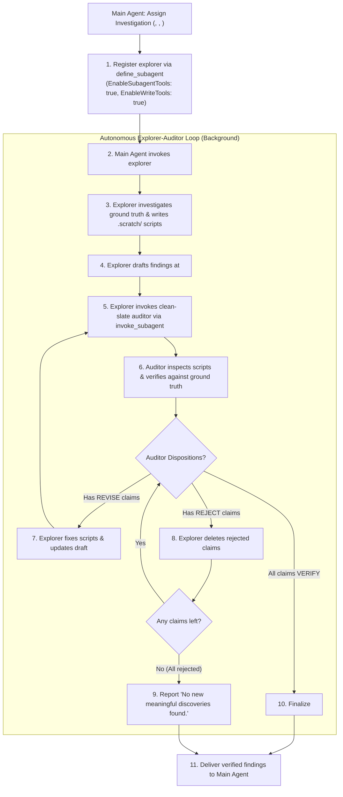

# Empirical Discovery Loop

Runs an autonomous loop where an Explorer investigates ground truth, drafts findings, invokes an independent clean-slate Auditor, and resolves all claims before delivering verified findings to the Main Agent.

## Directives

1. **Role Separation & Subagent Nesting**: Main Agent defines and spawns `explorer` (`EnableSubagentTools: true`, `EnableWriteTools: true`). `explorer` investigates ground truth and delegates auditing to a clean-slate `auditor` subagent. `explorer` NEVER self-audits.
2. **Ground-Truth Execution**: NEVER guess deeper dynamics from surface summaries. Deeper claims MUST be backed by executable scripts or tests in `.scratch/` against `<ground_truth>`.
3. **Adversarial Code Audit**: Auditors MUST treat `explorer` `.scratch/` scripts as suspect code: inspect line by line for logic bugs, sample leakage, silent drops (e.g. `dropna`, unhandled sentinel values), or flawed formulas, and verify numbers independently against `<ground_truth>`.
4. **Three-Way Dispositions**: Auditors MUST assign one disposition to every claim in `<target_doc_path>`:

| Disposition & Trigger | Explorer Action |
| :--- | :--- |
| `REVISE`: Directionally valid, but has numerical errors, indexing mistakes, or script bugs | Fix `.scratch/` scripts, correct numbers in `<target_doc_path>`, and re-invoke `auditor` |
| `REJECT`: Methodologically flawed, duplicates `<known_baseline>`, or adds zero value toward `<objective>` | Delete claim permanently from `<target_doc_path>` |
| `VERIFY`: 100% reproducible against `<ground_truth>` and delivers actionable value toward `<objective>` | Retain claim in `<target_doc_path>` for delivery |

5. **Hard Completion & Exit Hatch**: `explorer` MUST NOT report completion while any claim remains `REVISE`. If all claims are `REJECT`ed, prune the draft and report `"No new meaningful discoveries found."` (NEVER retain filler claims).
6. **Context Framing**: Pass `<known_baseline>` strictly as `"What is already known/claimed"` to challenge against ground truth, NEVER as predetermined conclusions to confirm.

## Workflow



1. **Main Agent**: If `explorer` is unregistered, call `define_subagent` (`Name: "explorer"`, `Description: "Investigator running autonomous exploration and managing adversarial auditing"`, `EnableSubagentTools: true`, `EnableWriteTools: true`). Invoke `explorer` with `<objective>`, `<known_baseline>`, `<target_scope>`, `<ground_truth>`, and `<target_doc_path>`, then await the final report without intermediate script churn.
2. **Explorer & Auditor**: Execute the loop above using the verbatim prompt contracts below; `auditor` concludes with a per-claim status table (`VERIFY`, `REVISE`, `REJECT`) listing exact code-level causes for revisions and justifications for rejections.

## Role Prompts

### Explorer Prompt Pattern (Main Agent to Explorer)
```text
You are an Explorer.
Explore target: <data_source_or_subsystem>.
Objective: <objective>.
Known baseline: <known_baseline>.
Target scope: <target_scope> (including other emergent area(s) if any valuable area that contributes directly to <objective> is discovered during exploration).
Ground truth: <ground_truth>.
Output target: <target_doc_path>.
Directives:
- Write and run diagnostic scripts in .scratch/ directly on ground truth.
- Do not stop at surface observations and guess deeper dynamics; all deeper findings require empirical proof from executed scripts or tests.
- "New discoveries" include completely new findings or deeper, unmentioned relationships among known elements.
- Draft your finding document at <target_doc_path>.
- Once drafted, invoke a clean-slate auditor subagent to adversarial-audit your scripts, numbers, and relevance to objective (<objective>).
- Resolution Loop:
  * For claims marked REVISE: fix your scripts and correct numbers.
  * For claims marked REJECT: delete them from the document.
  * Re-invoke auditor until all retained claims are VERIFIED.
  * Exit Hatch: If all proposed claims are REJECTED, report to Main Agent: "No new meaningful discoveries found."
- You MUST NOT report completion with unverified or unrevised claims.
```

### Auditor Prompt Pattern (Explorer to Auditor)
```text
You are an Adversarial Audit Specialist.
Objective: <objective>.
Known baseline: <known_baseline>.
Target to audit: <target_doc_path>.
Ground truth: <ground_truth>.
Directives:
- Adversarial Code Audit: Inspect scratch scripts in .scratch/ to audit implementation logic. Do NOT trust the code uncritically; check for hidden filters, data leakage, silent row drops, unhandled sentinel values, or arithmetic bugs.
- Ground-Truth Verification: Run tests against ground truth to verify numerical claims independently.
- Assign one of three explicit dispositions to EACH claim in <target_doc_path>:
  1. REVISE: Valid finding but numbers or code contain errors. Point out exact line of code and mechanism causing discrepancy.
  2. REJECT: Claim is flawed, duplicates known baseline (<known_baseline>), or lacks practical value towards objective (<objective>). Enforce aggressively against bloat.
  3. VERIFY: Claim is 100% reproducible from ground truth and delivers meaningful insight towards objective (<objective>).
- Conclude report with a summary table listing every claim and its status (VERIFY, REVISE, or REJECT).
```
