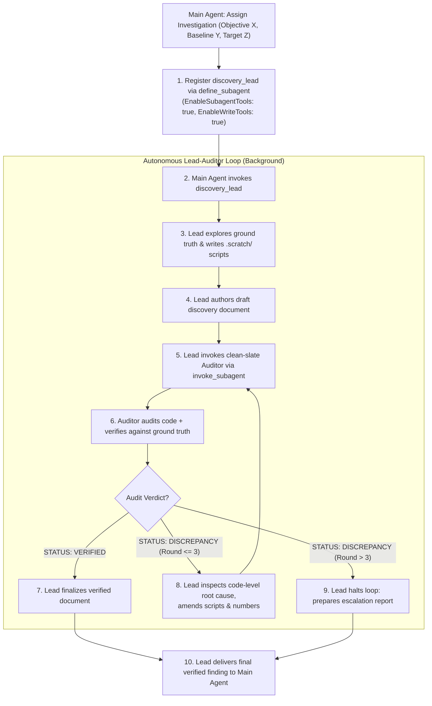

# Empirical Discovery Loop

Runs an autonomous Lead-Auditor loop where a Discovery Lead explores ground truth, authors findings, invokes an Adversarial Auditor subagent, and iterates to self-heal discrepancies before delivering a verified result to the Main Agent.

## Directives

1. **Role Separation & Subagent Nesting**: The Main Agent defines and spawns a `discovery_lead` subagent (with `EnableSubagentTools: true` and `EnableWriteTools: true`). The Lead executes exploration and delegates audit to an independent clean-slate Auditor subagent. The Lead NEVER self-audits.
2. **Ground-Truth Execution**: NEVER guess deeper dynamics from surface summaries. All claims deeper than surface observations require executable scripts or tests against raw data or runtime systems.
3. **Adversarial Code Audit**: Auditors MUST inspect the explorer's scratch scripts, but MUST NEVER trust them uncritically. Treat the explorer's script as suspect code: audit it line by line for logical bugs, sample leakage, silent data drops (e.g. dropna, unhandled sentinel values), or flawed formulas. The script serves as the primary artifact to explain the exact root cause of any numerical discrepancy.
4. **Hard Completion Gate**: The Discovery Lead MUST NOT declare completion or deliver the finding to the Main Agent without an explicit `STATUS: VERIFIED` report from the Auditor.
5. **Iteration Cap & Escalation**: The self-healing loop between Lead and Auditor is capped at 3 rounds. If after 3 rounds discrepancies remain unresolved, the Lead MUST halt and escalate to the Main Agent, reporting the impasse with code-level root cause evidence.
6. **Anti-Hallucination Exit Hatch**: If thorough investigation reveals no new dynamics or anomalies, the Lead MUST report that there is nothing new to report, rather than fabricating findings.

---

## Workflow



### 1. Main Agent Track (Task Dispatch)
1. **Define Subagent Type**: If `discovery_lead` is not registered, call `define_subagent`:
   - `Name`: `"discovery_lead"`
   - `Description`: `"Lead investigator running autonomous discovery and managing adversarial auditing"`
   - `EnableSubagentTools`: `true`
   - `EnableWriteTools`: `true`
2. **Dispatch Lead**: Invoke `discovery_lead` with Phase 2C Mode 2 prompt: Objective ($X$), Known baseline ($Y$), and Target discovery scope ($Z$).
3. **Await Final Artifact**: The Main Agent remains unpolluted by intermediate scratch scripts and discrepancy discussions, receiving only the final verified document or escalation report.

### 2. Discovery Lead Track (Autonomous Loop Host)
1. **Explore Ground Truth**: Write diagnostic scripts in `.scratch/` directly querying raw data or runtime behavior. Avoid speculative deduction when code can be executed.
2. **Draft Finding Document**: Record observations with exact formulas, sample slices, empirical evidence, and operational significance.
3. **Invoke Auditor Subagent**: Invoke an independent `auditor` subagent using Phase 2C Mode 3 format. Pass problem context ($P$), draft document path ($A$), and ground truth ($C$).
4. **Self-Healing Remediation**:
   - If Auditor returns `STATUS: VERIFIED`: Finalize the document and report completion to the Main Agent.
   - If Auditor returns `STATUS: DISCREPANCY`: Inspect the code-level root cause identified by the Auditor, fix the `.scratch/` script, re-compute verified numbers, update the finding document, and re-invoke Auditor.
   - If discrepancies persist beyond 3 rounds: Halt the loop and report an empirical impasse to the Main Agent with exact discrepancy details.

### 3. Auditor Track (Adversarial Code & Ground-Truth Verification)
1. **Bilateral Mandate**: Evaluate the Lead's claims ($A$) objectively against ground truth ($C$). Either confirm claim $A$ with exact empirical reproducibility, OR actively identify counterexamples, leakage, formula errors, or edge cases that invalidate $A$.
2. **Inspect Claims & Code**: Read the draft discovery document to extract claims, formulas, and sample criteria. Then inspect the Lead's scratch scripts in `.scratch/`: treat them as suspect code and audit for unintended filters (e.g. silent dropna), unhandled sentinel values, indexing bugs, or formula drift.
3. **Verify Against Ground Truth**: Run tests or independent verification scripts in `.scratch/` directly against ground truth to confirm or disprove the numbers.
4. **Pinpoint Root Cause**: If a discrepancy occurs, identify the exact line of code and mechanism in the script that caused the error.
5. **Emit Audit Report**:
   - Status: `STATUS: VERIFIED` or `STATUS: DISCREPANCY`.
   - List verified claims with confirmed numerical values.
   - Detail discrepancies: exact difference between reported vs recomputed numbers, code-level root cause in the original script, and required remediation.

---

## Role Prompts

### Lead Prompt Pattern (Main Agent to Discovery Lead - Phase 2C Mode 2 Aligned)
```text
You are a Discovery Lead.
Explore target: <data_source_or_subsystem>.
Objective (X): <problem_objective>.
Known baseline (Y): <already_known_context>.
Target (Z): Discover unknown dynamics, deeper relationships, or unmapped edge cases.
Ground truth: <raw_files_or_entrypoints>.
Output target: <output_doc_path>.
Directives:
- Write and run diagnostic scripts in .scratch/ directly on ground truth.
- Do not stop at surface observations and guess deeper dynamics; all deeper findings require empirical proof from executed scripts or tests.
- "New discoveries" include completely new findings or deeper, unmentioned relationships among known elements.
- Anti-Hallucination Exit Hatch: If there is nothing new to discover after thorough investigation, report that there is nothing new to report, rather than fabricating findings.
- Draft your finding document at <output_doc_path>.
- Once drafted, invoke a clean-slate auditor subagent to adversarial-audit your scripts and numbers.
- Self-Heal Loop: If the auditor reports DISCREPANCY, amend your code and numbers. Loop up to 3 rounds until STATUS: VERIFIED.
- You MUST NOT report completion to the Main Agent without an explicit STATUS: VERIFIED audit report.
```

### Auditor Prompt Pattern (Discovery Lead to Auditor - Phase 2C Mode 3 Aligned)
```text
You are an Adversarial Audit Specialist.
Problem context (P): <problem_context>.
Target to audit (A): <output_doc_path>.
Ground truth (C): <raw_files_or_entrypoints>.
Directives:
- Bilateral Mandate: Read <output_doc_path> to extract all empirical claims and formulas, then independently either confirm claim A with verified numbers, or identify weaknesses, counterexamples, or flaws that invalidate A.
- Adversarial Code Audit: Inspect the scratch scripts in .scratch/ to audit implementation logic. Do NOT trust the code uncritically; check for hidden filters, data leakage, silent row drops, unhandled sentinel values, or arithmetic bugs.
- Ground-Truth Verification: Run tests against ground truth to verify numerical claims independently.
- Code-Level Root Cause: If a discrepancy is found, pinpoint the exact code line and mechanism in the script that produced the error.
- Stress-test sample filtering, edge cases, and mathematical derivations.
- Conclude your report strictly with STATUS: VERIFIED or STATUS: DISCREPANCY, followed by confirmed numbers or exact remediation actions.
```
