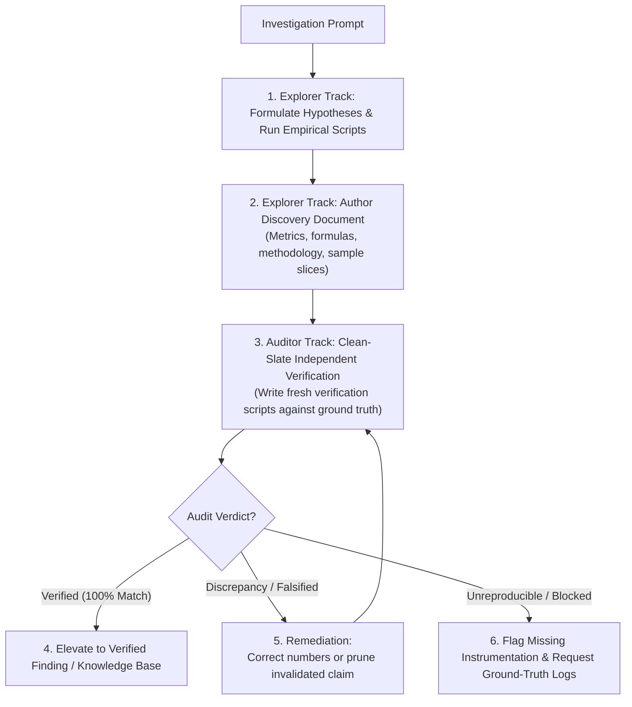

# Empirical Discovery Loop

Runs a dual-track loop pairing autonomous exploratory discovery with clean-slate adversarial auditing to verify empirical claims against ground truth.

## Directives

1. **Role Separation**: NEVER allow an explorer to audit its own findings. The author of a hypothesis has confirmation bias; auditing MUST execute in a clean-slate context.
2. **Ground-Truth Execution**: NEVER guess deeper dynamics from surface summaries. All claims deeper than surface observations require executable scripts or tests against raw data or runtime systems.
3. **Auditor Clean-Slate Invariant**: Auditors MUST NOT read or execute the explorer's scratch scripts. Auditors write independent verification scripts from scratch using only the stated methodology and raw ground truth.
4. **Adversarial Falsification**: Auditors MUST actively search for counterexamples, sample leakage, slicing bias, formula errors, and edge cases that invalidate the finding.
5. **Remediation Gate**: Findings with unverified discrepancies MUST NOT be merged or cited as ground truth. Discredited claims MUST be pruned or corrected immediately.

---

## Workflow



### 1. Explorer Track (Discovery & Measurement)
1. **Define Question**: Identify the target behavior, performance metric, or dataset distribution to explore.
2. **Execute Empirical Scripts**: Write focused diagnostic scripts in `.scratch/` directly querying ground-truth data or runtime behavior. Avoid speculative deduction when code can be executed.
3. **Record Findings**: Document observations in a discovery document. Include:
   - Specific metrics, equations, and exact sample slices.
   - Empirical evidence (benchmark timings, distributions, confusion matrices, or log traces).
   - Domain interpretation and operational significance.

### 2. Auditor Track (Adversarial Verification)
1. **Read Discovery Document Only**: The auditor reads the target document to identify empirical claims, formulas, and sample filters. The auditor MUST NOT inspect `.scratch/` scripts authored by the explorer.
2. **Write Independent Verification Script**: Author a fresh test script in `.scratch/` implementing the stated calculation independently from ground-truth data.
3. **Compare Results**:
   - Recompute every reported metric, percentage, p-value, and threshold.
   - Test edge cases, missing value handling, and denominator definitions.
4. **Emit Audit Report**:
   - Report status: `VERIFIED` or `DISCREPANCY`.
   - List verified claims with confirmed numerical values.
   - Detail discrepancies: exact difference between reported vs recomputed numbers, root cause (e.g. sample leakage, filtering mismatch, arithmetic error), and required remediation.

### 3. Remediation & Cleaning
- **Numerical Discrepancy**: Correct the finding document with independently verified numbers and update conclusions accordingly.
- **Methodological Invalidation**: If the premise is falsified or based on sample leakage, delete or rewrite the finding document.
- **Ambiguous / Unreproducible**: If behavior cannot be reproduced deterministically, add runtime logging to isolate the variable before re-auditing.

---

## Role Prompts

### Explorer Prompt Pattern
```text
You are an Empirical Discovery Specialist.
Explore target: <data_source_or_subsystem>.
Research objectives: <questions_or_hypotheses>.
Ground truth: <raw_files_or_entrypoints>.
Directives:
- Write and run diagnostic scripts in .scratch/ directly on ground truth.
- Do not stop at surface metrics; test multi-variable interactions and inflection points empirically.
- Write your findings to <output_doc_path> including exact methodology, sample sizes, and numbers.
```

### Auditor Prompt Pattern
```text
You are an Adversarial Audit Specialist.
Target to audit: <output_doc_path>.
Ground truth: <raw_files_or_entrypoints>.
Directives:
- Read <output_doc_path> to extract all numerical claims, formulas, and sample criteria.
- DO NOT read any scratch scripts written by the explorer.
- Write a fresh script in .scratch/ to independently recompute every number from ground truth.
- Stress-test sample filtering, edge cases, and mathematical derivations.
- Write your audit report to <audit_report_path> with verdict (VERIFIED or DISCREPANCY) and exact remediation actions.
```
