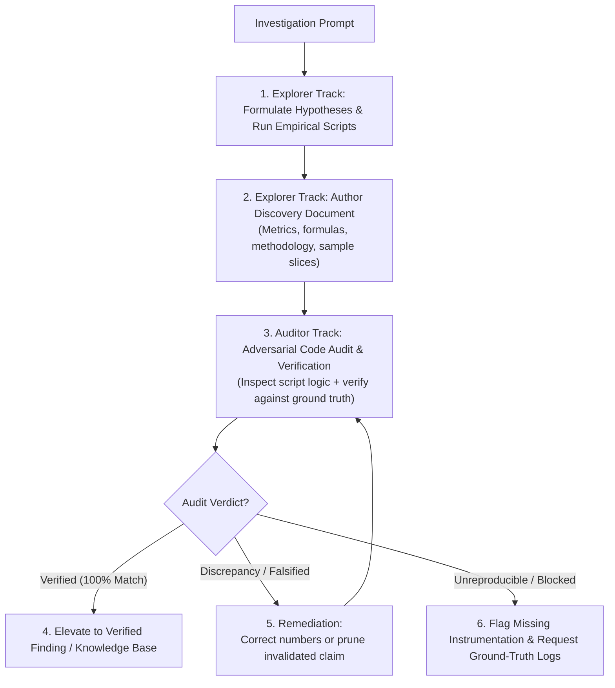

# Empirical Discovery Loop

Runs a dual-track loop pairing autonomous exploratory discovery with adversarial code auditing to verify empirical claims against ground truth.

## Directives

1. **Role Separation**: NEVER allow an explorer to audit its own findings. The author of a hypothesis has confirmation bias; auditing MUST execute in a clean-slate context.
2. **Ground-Truth Execution**: NEVER guess deeper dynamics from surface summaries. All claims deeper than surface observations require executable scripts or tests against raw data or runtime systems.
3. **Adversarial Code Audit**: Auditors MUST inspect the explorer's scratch scripts, but MUST NEVER trust them uncritically. Treat the explorer's script as suspect code: audit it line by line for logical bugs, sample leakage, silent data drops (e.g. dropna, unhandled sentinel values), or flawed formulas. The script serves as the primary artifact to explain the exact root cause of any numerical discrepancy.
4. **Adversarial Falsification**: Auditors MUST actively search for counterexamples, sample leakage, slicing bias, formula errors, and edge cases that invalidate the finding.
5. **Remediation Gate**: Findings with unverified discrepancies MUST NOT be merged or cited as ground truth. Discredited claims MUST be pruned or corrected immediately.
6. **Anti-Hallucination Exit Hatch**: Explorers MUST report that there is nothing new to report when investigation reveals no new dynamics. Fabricating claims or padding reports is strictly forbidden.

---

## Workflow



### 1. Explorer Track (Discovery & Measurement)
1. **Define Objective & Baseline**: Provide the overarching objective ($X$), established known context ($Y$), and target discovery area ($Z$). NEVER pre-bake hypotheses or desired answers into the prompt.
2. **Execute Empirical Scripts**: Write focused diagnostic scripts in `.scratch/` directly querying ground-truth data or runtime behavior. Avoid speculative deduction when code can be executed.
3. **Broad Scope of New Discoveries**: New discoveries encompass both novel facts and deeper, unmentioned relationships or interactions among known elements.
4. **Exit Hatch**: If thorough investigation reveals no new findings or anomalies, the explorer MUST report that there is nothing new to report, rather than fabricating claims.
5. **Record Findings**: Document observations in a discovery document. Include:
   - Specific metrics, equations, and exact sample slices or runtime traces.
   - Empirical evidence (benchmark timings, distributions, confusion matrices, or log traces).
   - Domain interpretation and operational significance.

### 2. Auditor Track (Adversarial Verification)
1. **Bilateral Mandate**: Evaluate the explorer's claims ($A$) objectively against ground truth ($C$). The mission is two-sided: either confirm claim $A$ with exact empirical reproducibility, OR actively search for counterexamples, leakage, formula errors, or edge cases that invalidate $A$.
2. **Inspect Claims & Code**: Read the target discovery document to extract claims, formulas, and filtering criteria. Then inspect the explorer's scratch scripts in `.scratch/`: treat them as suspect code and audit for unintended filters (e.g. silent dropna), unhandled sentinel values, indexing bugs, or formula drift.
3. **Verify Against Ground Truth**: Run verification tests or independent validation scripts in `.scratch/` directly against ground truth to confirm or disprove the numbers.
4. **Pinpoint Root Cause**: If a discrepancy occurs, identify the exact line of code and mechanism in the explorer's script that caused the error.
5. **Emit Audit Report**:
   - Report status: `VERIFIED` or `DISCREPANCY`.
   - List verified claims with confirmed numerical values.
   - Detail discrepancies: exact difference between reported vs recomputed numbers, code-level root cause in the original script, and required remediation.

### 3. Remediation & Cleaning
- **Numerical Discrepancy**: Correct the finding document with independently verified numbers and update conclusions accordingly.
- **Methodological Invalidation**: If the premise is falsified or based on sample leakage, delete or rewrite the finding document.
- **Ambiguous / Unreproducible**: If behavior cannot be reproduced deterministically, add runtime logging to isolate the variable before re-auditing.

---

## Role Prompts

### Explorer Prompt Pattern (Phase 2C Mode 2 Aligned)
```text
You are an Empirical Discovery Specialist.
Explore target: <data_source_or_subsystem>.
Objective (X): <problem_objective>.
Known baseline (Y): <already_known_context>.
Target (Z): Discover unknown dynamics, deeper relationships, or unmapped edge cases.
Ground truth: <raw_files_or_entrypoints>.
Directives:
- Write and run diagnostic scripts in .scratch/ directly on ground truth.
- Do not stop at surface observations and guess deeper dynamics; all deeper findings require empirical proof from executed scripts or tests.
- "New discoveries" include completely new findings or deeper, unmentioned relationships among known elements.
- Anti-Hallucination Exit Hatch: If there is nothing new to discover after thorough investigation, you MUST report that there is nothing new to report, rather than fabricating findings.
- Write your findings to <output_doc_path> including exact methodology, sample sizes, and numbers.
```

### Auditor Prompt Pattern (Phase 2C Mode 3 Aligned)
```text
You are an Adversarial Audit Specialist.
Problem context (P): <problem_context>.
Target to audit (A): <output_doc_path>.
Ground truth (C): <raw_files_or_entrypoints>.
Directives:
- Bilateral Mandate: Read <output_doc_path> to extract all empirical claims and formulas, then independently either confirm claim A with verified numbers, or identify weaknesses, counterexamples, or flaws that invalidate A.
- Adversarial Code Audit: Inspect the explorer's scratch scripts in .scratch/ to audit implementation logic. Do NOT trust the code uncritically; check for hidden filters, data leakage, silent row drops, unhandled sentinel values, or arithmetic bugs.
- Ground-Truth Verification: Run tests against ground truth to verify numerical claims independently.
- Code-Level Root Cause: If a discrepancy is found, pinpoint the exact code line and mechanism in the explorer's script that produced the error.
- Stress-test sample filtering, edge cases, and mathematical derivations.
- Write your audit report to <audit_report_path> with verdict (VERIFIED or DISCREPANCY) and exact remediation actions.
```
