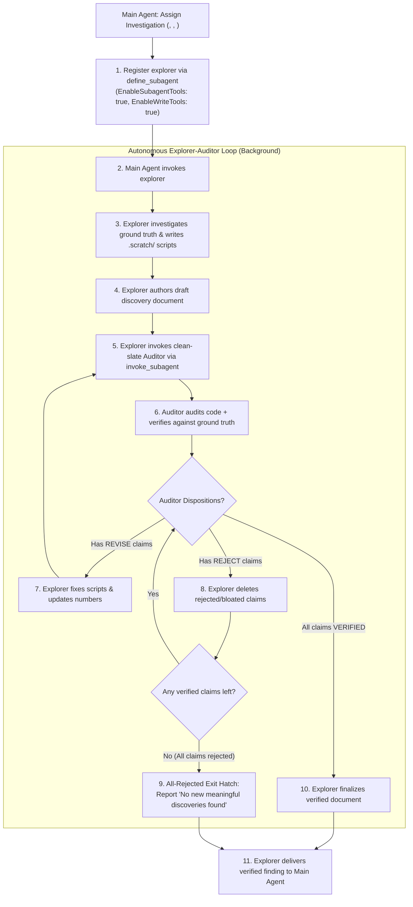

# Empirical Discovery Loop

Runs an autonomous loop where an Explorer investigates ground truth, drafts findings, invokes an independent clean-slate Auditor, and resolves all claims before delivering verified findings to the Main Agent.

## Directives

1. **Role Separation & Subagent Nesting**: The Main Agent defines and spawns an `explorer` subagent (with `EnableSubagentTools: true` and `EnableWriteTools: true`). The Explorer executes exploration and delegates audit to an independent clean-slate Auditor subagent. The Explorer NEVER self-audits.
2. **Ground-Truth Execution**: NEVER guess deeper dynamics from surface summaries. All claims deeper than surface observations require executable scripts or tests against raw data or runtime systems.
3. **Adversarial Code Audit**: Auditors MUST inspect the Explorer's scratch scripts, but MUST NEVER trust them uncritically. Treat the Explorer's script as suspect code: audit it line by line for logical bugs, sample leakage, silent data drops (e.g. dropna, unhandled sentinel values), or flawed formulas. The script serves as the primary artifact to explain the exact root cause of any numerical discrepancy.
4. **Three-Way Auditor Dispositions**: For every claim in the draft, the Auditor MUST assign one of three explicit dispositions:

| Disposition | Trigger Condition | Required Action |
| :--- | :--- | :--- |
| `REVISE` | Claim is directionally valid, but contains numerical discrepancies, indexing errors, or script bugs. | Explorer fixes `.scratch/` scripts, updates numbers in draft, and re-invokes Auditor. |
| `REJECT` | Claim is methodologically flawed, duplicates `<known_baseline>`, or provides zero operational value towards `<objective>`. | Explorer permanently deletes claim from draft document. |
| `VERIFY` | Claim and supporting numbers are 100% reproducible against ground truth and provide actionable value towards `<objective>`. | Explorer retains claim in document for final delivery. |

5. **Hard Completion Gate**: The Explorer MUST NOT declare completion or deliver findings to the Main Agent while any claim remains in `REVISE` status. Every claim must either be verified or pruned.
6. **All-Rejected Exit Hatch**: If all proposed claims in the draft are rejected by the Auditor (due to invalidity, duplication, or lack of value towards `<objective>`), the Explorer MUST prune the draft and report to the Main Agent: "No new meaningful discoveries found." NEVER invent or retain low-value filler claims to avoid an empty report.
7. **Context Framing Mandate**: When passing supplementary context, domain knowledge, or baseline materials to the Explorer, the Main Agent MUST frame them strictly under `Known baseline` ("What is already known" or "What is currently claimed"). NEVER frame supplementary materials as answers or conclusions for the Explorer to echo. The Explorer treats known context as a baseline to challenge against ground truth, never as predetermined facts to parrot.

---

## Workflow



### 1. Main Agent Track (Task Dispatch)
1. **Define Subagent Type**: If `explorer` is not registered, call `define_subagent`:
   - `Name`: `"explorer"`
   - `Description`: `"Investigator running autonomous exploration and managing adversarial auditing"`
   - `EnableSubagentTools`: `true`
   - `EnableWriteTools`: `true`
2. **Dispatch Explorer**: Invoke `explorer` using the Explorer Prompt Pattern. Supply `<objective>`, `<known_baseline>`, `<target_scope>`, `<ground_truth>`, and `<target_doc_path>`. Package attached reference materials strictly under `Known baseline` as "What is already known/claimed", never as expected conclusions to validate.
3. **Await Final Artifact**: The Main Agent avoids intermediate scratch scripts and debugging churn, receiving only the final verified document or the "no new discoveries" report.

### 2. Explorer Track (Autonomous Loop Host)
1. **Investigate Ground Truth**: Write diagnostic scripts in `.scratch/` directly querying raw data or runtime behavior. Avoid speculative deduction when code can be executed.
2. **Draft Finding Document**: Record observations at `<target_doc_path>` with exact formulas, sample slices, empirical evidence, and operational significance.
3. **Invoke Auditor Subagent**: Invoke an independent `auditor` subagent using the Auditor Prompt Pattern. Pass `<objective>`, `<known_baseline>`, `<target_doc_path>`, and `<ground_truth>`.
4. **Resolve Claims**:
   - For `REVISE` claims: Inspect code-level root causes flagged by Auditor, fix `.scratch/` scripts, update numbers in `<target_doc_path>`, and re-invoke Auditor.
   - For `REJECT` claims: Delete them immediately from `<target_doc_path>`.
   - If ALL claims are rejected: Conclude the loop and report to Main Agent: "No new meaningful discoveries found."
   - When all retained claims achieve `VERIFY`: Finalize document and deliver to Main Agent.

### 3. Auditor Track (Adversarial Code & Value Audit)
1. **Inspect Claims & Code**: Read `<target_doc_path>` to extract claims, formulas, and sample criteria. Inspect the Explorer's scripts in `.scratch/` as suspect code for unintended filters (e.g. silent dropna), unhandled sentinel values, indexing bugs, or formula drift.
2. **Verify Against Ground Truth**: Run independent verification scripts in `.scratch/` directly against `<ground_truth>`.
3. **Assign Dispositions**: Assign `REVISE`, `REJECT`, or `VERIFY` to every individual claim per Directive 4.
4. **Emit Audit Report**: Output table of claims with dispositions, code-level root causes for revisions, and explicit justifications for rejections.

---

## Role Prompts

### Explorer Prompt Pattern (Main Agent to Explorer)
```text
You are an Explorer.
Explore target: <data_source_or_subsystem>.
Objective: <objective>.
Known baseline: <known_baseline>.
Target scope: <target_scope>.
Ground truth: <ground_truth>.
Output target: <target_doc_path>.
Directives:
- Write and run diagnostic scripts in .scratch/ directly on ground truth.
- Do not stop at surface observations and guess deeper dynamics; all deeper findings require empirical proof from executed scripts or tests.
- "New discoveries" include completely new findings or deeper, unmentioned relationships among known elements.
- Draft your finding document at <target_doc_path>.
- Once drafted, invoke a clean-slate auditor subagent to adversarial-audit your scripts, numbers, and relevance to objective (<objective>).
- Resolution Loop:
  * For claims marked REVISE: fix your scripts and correct numbers.
  * For claims marked REJECT: delete them from the document.
  * Re-invoke auditor until all retained claims are VERIFIED.
  * Exit Hatch: If all proposed claims are REJECTED, report to Main Agent: "No new meaningful discoveries found."
- You MUST NOT report completion with unverified or unrevised claims.
```

### Auditor Prompt Pattern (Explorer to Auditor)
```text
You are an Adversarial Audit Specialist.
Objective: <objective>.
Known baseline: <known_baseline>.
Target to audit: <target_doc_path>.
Ground truth: <ground_truth>.
Directives:
- Adversarial Code Audit: Inspect scratch scripts in .scratch/ to audit implementation logic. Do NOT trust the code uncritically; check for hidden filters, data leakage, silent row drops, unhandled sentinel values, or arithmetic bugs.
- Ground-Truth Verification: Run tests against ground truth to verify numerical claims independently.
- Assign one of three explicit dispositions to EACH claim in <target_doc_path>:
  1. REVISE: Valid finding but numbers or code contain errors. Point out exact line of code and mechanism causing discrepancy.
  2. REJECT: Claim is flawed, duplicates known baseline (<known_baseline>), or lacks practical value towards objective (<objective>). Enforce aggressively against bloat.
  3. VERIFY: Claim is 100% reproducible from ground truth and delivers meaningful insight towards objective (<objective>).
- Conclude report with a summary table listing every claim and its status (VERIFY, REVISE, or REJECT).
```
