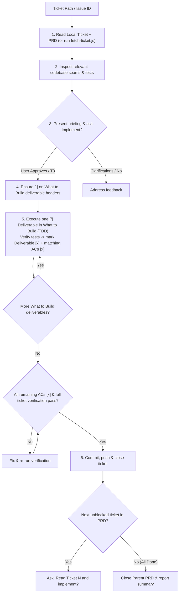

# Implement a Ticket

Execute well-specified tickets directly from their `What to Build` deliverables and `Acceptance Criteria` without creating a separate `implementation_plan.md`.

## Directives

1. **Zero Re-Planning**: NEVER generate `implementation_plan.md`; use the ticket file itself as the live execution plan.
2. **Pre-Flight Deliverable Checkboxes**: Before writing code, inspect `## What to Build` in the ticket file. If its deliverables (e.g. `### 1. <Deliverable>` or numbered items) lack GFM task-list checkboxes (`- [ ]`), convert each deliverable header/entry to `- [ ] 1. <Deliverable>` so mid-ticket checkpoints record exact module-level progress in valid GFM syntax.
3. **Two-Layer Single-Step Progression (`What to Build` -> `Acceptance Criteria`)**:
   - Mark at most **one** `## What to Build` deliverable `[/]` at a time.
   - Implement and unit-test that deliverable via TDD, run verification commands, then mark the deliverable `[x]` and simultaneously mark `[x]` on every `## Acceptance Criteria` item proven by those tests.
   - After all `## What to Build` deliverables are `[x]`, verify and check off any remaining cross-cutting `## Acceptance Criteria` items before committing.
4. **Targeted Seam Exploration**: Inspect only the codebase seams and tests relevant to the active ticket.

## Workflow

1. **Fetch & Brief**:
   - Read the local ticket and parent `PRD.md` directly (or for remote-only issues, run `node <skill-dir>/scripts/fetch-ticket.js <ticket-number-or-url>` to pull `.scratch/tickets/ticket_<number>.md` and `prd_<parent>.md`).
   - Inspect touched seams and tests, then present a concise briefing (`Ticket`, `Parent PRD`, `Touched Seams`, `Deliverables & Acceptance Criteria`) and ask `"Implement Ticket #<number>?"` (skip confirmation when dispatched autonomously by `implement-with-subagents`).
2. **Execute & Verify**:
   - Normalize `## What to Build` deliverables to GFM task-list items (`- [ ] 1. <Deliverable>`) if missing.
   - Advance one `[/]` deliverable at a time: write tests alongside minimal code edits, run verification, mark the deliverable `[x]`, and check off (`[x]`) satisfied `## Acceptance Criteria` items.
3. **Commit, Close & Handoff**:
   - Commit atomically: `git commit -m "<type>(<scope>): 
 (closes #<number>)"`.
   - When working against remote issues without `closes #<number>` auto-close, run `node <skill-dir>/scripts/close-ticket.js <ticket-number> --comment "Implemented and verified with unit tests."`
   - If another unblocked ticket exists in the PRD, ask `"Do you want me to read Ticket <next-number> and implement?"`.
