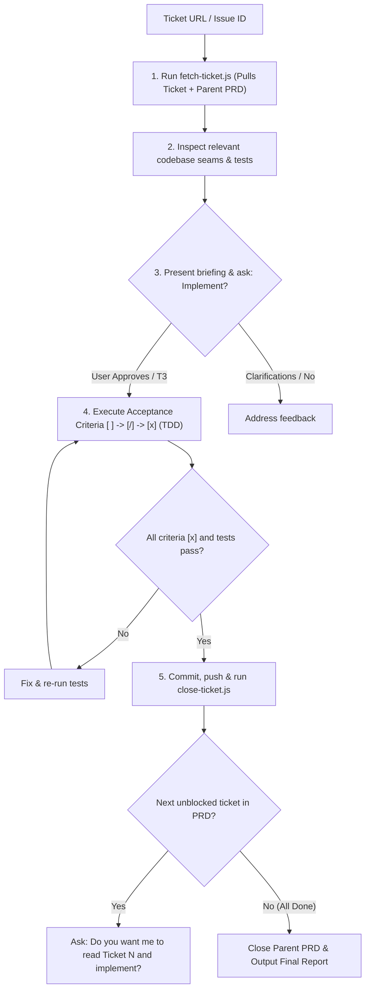

# Implement a Ticket

Execute mature, well-specified tickets directly from their acceptance criteria without recreating redundant implementation plans.

## Directives

1. **Zero Re-Planning**: NEVER generate `implementation_plan.md` when a ticket already has an Acceptance Criteria checklist; use the ticket checklist as the execution plan.
2. **Targeted Seam Exploration**: Inspect only the codebase seams and tests relevant to the ticket before editing.
3. **Single-Step Progression**: Advance criteria sequentially (`[ ]` -> `[/]` max 1 active -> `[x]`) and verify with test/build commands before marking `[x]`.

## Workflow

1. **Fetch & Brief**:
   - Run `node <skill-dir>/scripts/fetch-ticket.js <ticket-number-or-url>` and read `.scratch/tickets/ticket_<number>.md` and `.scratch/tickets/prd_<parent>.md` directly.
   - Inspect touched seams and tests, then present a concise briefing (`Ticket: #<number> - <Title>`, `Parent PRD: #<parent>`, `Touched Seams`, `Acceptance Criteria (<N> items)`) and ask `"Implement Ticket #<number>?"`.
2. **Execute & Verify**: On approval, work one `[/]` item at a time (write tests first or alongside minimal edits, run verification commands, mark `[x]` before advancing).
3. **Commit, Close & Handoff**:
   - Commit atomically: `git commit -m "feat(<scope>): <message> (closes #<number>)"`.
   - Close ticket: `node <skill-dir>/scripts/close-ticket.js <ticket-number> --comment "Implemented and verified with unit tests."`
   - If another unblocked ticket exists in the PRD, ask `"Do you want me to read Ticket <next-number> and implement?"`.
   - When all tickets in the PRD are done, run `node <skill-dir>/scripts/close-ticket.js <parent-prd-number> --comment "All child tickets completed and verified."` and report the summary.
