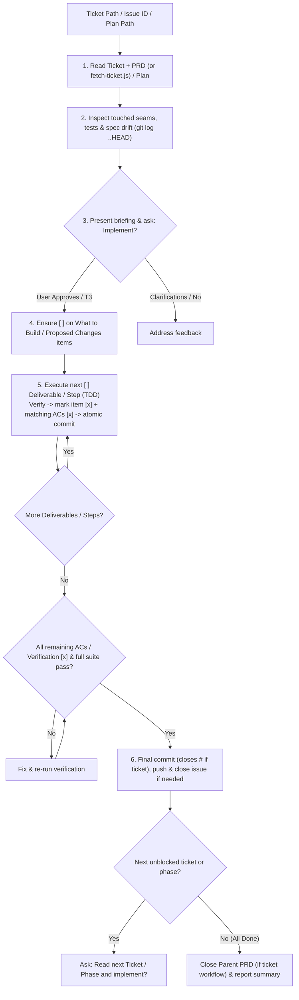

# Implement

Execute well-specified tickets (local or GitHub issue) and approved implementation plans (`implementation_plan.md` or standalone plan doc) directly from their deliverables/proposed changes and acceptance criteria without creating a duplicate plan.

## Directives

1. **Zero Duplicate Planning**: NEVER generate a duplicate `implementation_plan.md`; use the target ticket or plan file itself as the live execution plan.
2. **Pre-Flight Deliverable Checkboxes**: Before writing code, inspect `## What to Build` (tickets) or `## Proposed Changes` / phase steps (plans). If deliverables or steps (e.g. `### 1. <Deliverable>` or bare numbered entries) lack GFM task-list checkboxes (`- [ ]`), convert each deliverable/step header to `- [ ] 1. **<Deliverable>**` so mid-execution checkpoints record completed work in valid GFM syntax.
3. **Two-Layer Direct Completion**:
   - Execute deliverables or steps sequentially one at a time via TDD without intermediate `[/]` edits.
   - Implement and test the active deliverable/step, run verification commands, then toggle `- [ ]` -> `- [x]` directly on that deliverable/step AND on every `## Acceptance Criteria` / `## Verification Plan` item proven by those tests.
   - When toggling checkboxes in `What to Build`, `Proposed Changes`, `Acceptance Criteria`, or `Verification Plan`, patch ONLY the minimal unique prefix (or scoped line range) instead of echoing entire lines or paragraphs.
   - After all deliverables/steps are `[x]`, verify and check off any remaining cross-cutting `## Acceptance Criteria` / `## Verification Plan` items before the final commit.
4. **Targeted Seam Exploration**: Inspect only the codebase seams and tests relevant to the active work unit.
5. **Pre-Flight Review Gate & Spec Drift Check**: For Ticket/PRD targets, check `Review Status` in the parent `PRD.md` header before writing code: if `TO_BE_REVIEWED` (and the user has not explicitly authorized implementing an unreviewed draft), STOP and ask whether to run review first or proceed. Next, for all targets (tickets or plans), resolve the baseline commit from `Reviewed-At-Commit` in the parent PRD, ticket, or plan header, falling back to `git log -n 1 --format=%H -- <target-path-or-spec-dir>` if missing. When a commit SHA is found, run `git log --oneline <sha>..HEAD -- <touched-paths>` (if untracked/empty, verify touched files and symbols directly on disk). If commits landed in overlapping scope after review or planning, inspect their diff and reconcile live defaults, protocols, and handlers before coding (preserve newer live behavior unless it directly contradicts a core requirement; escalate to the user on semantic contradiction).
6. **Unasked-Change Guard & Considerate Porting**: Read `Change Mode` and `## Intentional Deltas` (from parent `PRD.md` or plan scope guards / `Replaces:` markers) before coding. Implement only what is explicitly specified; do NOT alter, restyle, or remove unasked behaviors or controls. When modifying, migrating, or replacing an existing file or component (including `[NEW]` deliverables declaring `Replaces: <legacy-file-path(s)>`), read the live legacy implementation and its paired assets/stylesheets/tests first. Underlying implementation layers may change per ticket or plan (e.g. DOM to VDOM, file relocation), while all existing observable behavior, contracts, and `initial intended UXUI` default to **PRESERVE** unless explicitly listed under `INTENTIONALLY_CHANGED` in `PRD.md` or specified in the plan.
7. **Atomic Conventional Commits**: Commit each verified logical change atomically (`<type>(<scope>): 
`) per Global Policy instead of bundling an entire ticket or plan into one commit. For GitHub-tracked tickets, attach `(closes #<number>)` ONLY to the final commit that completes all deliverables and acceptance criteria (never on intermediate commits).

## Workflow

1. **Fetch & Brief**:
   - Read the target file (local ticket + parent `PRD.md`, or approved implementation plan) directly. For Ticket/PRD targets, inspect `Review Status`, `Change Mode`, `Reviewed-At-Commit`, and `## Intentional Deltas` (for remote-only issues, run `node <skill-dir>/scripts/fetch-ticket.js <ticket-number-or-url>` to pull `.scratch/tickets/ticket_<number>.md` and `prd_<parent>.md`). If `PRD.md` marks `Review Status: TO_BE_REVIEWED` (without explicit authorization to implement unreviewed drafts), warn upfront and ask whether to review first or proceed.
   - Inspect touched seams and tests (running `git log --oneline <sha>..HEAD -- <touched-paths>` when a baseline commit is resolved, and reading live files + paired stylesheets before porting/replacing them), then present a concise briefing (`Target Ticket / Plan`, `Parent PRD` if applicable, `Touched Seams`, `Spec Drift` if any, `Deliverables & Acceptance Criteria`) and ask `"Implement <Ticket #<number> | Plan>?"` (skip briefing confirmation when dispatched autonomously by `implement-with-subagents` after orchestrator review-gate clearance).
2. **Execute & Verify**:
   - Normalize `## What to Build` (tickets) or `## Proposed Changes` / phase steps (plans) to GFM task-list items (`- [ ] 1. **<Deliverable>**`) if missing.
   - Advance one deliverable/step at a time without intermediate `[/]` edits: write tests alongside minimal code edits, run verification, then mark the deliverable/step `[x]` and check off (`[x]`) satisfied `## Acceptance Criteria` / `## Verification Plan` items by patching only the minimal unique checkbox prefix (or scoped line range).
   - Commit each verified logical change atomically (`<type>(<scope>): 
`) before advancing when deliverables represent independent logical units (for example, `refactor:` seam preparation separated from `feat:` behavior).
3. **Finalize, Close & Handoff**:
   - Verify any remaining cross-cutting `## Acceptance Criteria` and `## Verification Plan` items, then make the final atomic commit: `git commit -m "<type>(<scope>): 
"` (appending ` (closes #<number>)` ONLY on this final commit for GitHub-tracked tickets).
   - When working against remote issues without `closes #<number>` auto-close, run `node <skill-dir>/scripts/close-ticket.js <ticket-number> --comment "Implemented and verified with unit tests."`
   - If another unblocked ticket or remaining plan phase exists, ask `"Do you want me to read <Ticket <next-number> | Phase <next>> and implement?"`.
