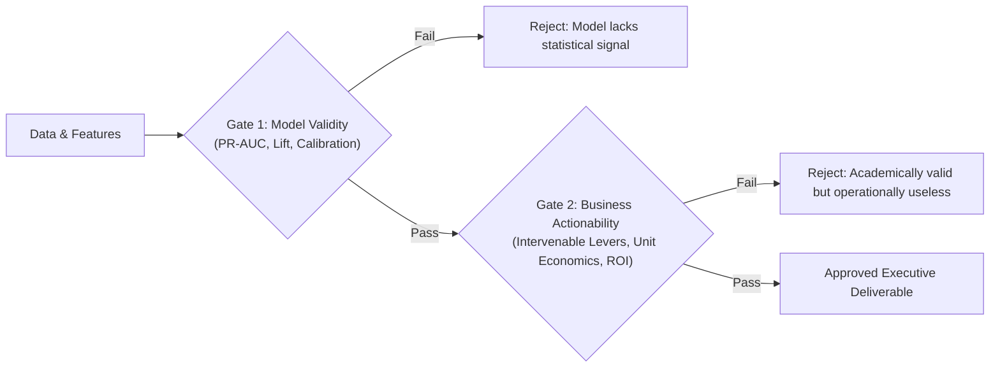

# Applied Business ML: Strategy Consulting, Unit Economics, & Decision Science

Audits the translation of machine learning models into actionable business proposals, financial impact quantification, operational decision thresholds, feature intervenability, and executive presentation architecture.

---

## 1. The Two-Tier Validation Gate

Every analytical ticket and Directive Artifact must pass through two sequential gates before acceptance:



- [ ] **Gate 1 (Model Validity Gate)**: Verify the model achieves meaningful discriminative lift over naive baselines (e.g. majority class or random prior). For imbalanced classification, evaluate PR-AUC, Recall@TopK, and Brier score. Reject models that fail to outperform simple baselines.
- [ ] **Gate 2 (Business Actionability Gate)**: Verify that top predictive features correspond to **operational levers** that the business can realistically modify (e.g. equipment replacement, service outreach, tariff adjustment). Reject proposals where predictions rely entirely on immutable demographic traits (e.g. age, gender, marital status).
- [ ] **Quantified Financial Impact**: Mandate explicit computation of expected financial ROI:
  $$\text{Net ROI} = (\text{Retained Customers} \times \text{Customer Value} \times \text{Success Rate}) - \text{Intervention Campaign Costs}$$
  Reject proposals that terminate at raw classification accuracy without translating predictions into monetary value.

---

## 2. Expected Value Framework & Threshold Optimization

A classification threshold of $\tau = 0.5$ is an arbitrary mathematical convention. In business operations, false positives and false negatives carry asymmetric financial consequences:

- [ ] **Cost-Benefit Matrix Construction**: Explicitly define the monetary payoffs and costs for each quadrant:
  | Outcome | Business Event | Financial Impact Equation |
  | :--- | :--- | :--- |
  | **True Positive (TP)** | Churner correctly flagged; accepted retention offer | $B_{TP} = (\text{Retained Margin} \times \text{Offer Take Rate}) - \text{Intervention Cost}$ |
  | **False Positive (FP)** | Loyal customer flagged; unnecessary outreach | $C_{FP} = \text{Intervention Cost} + \text{Margin Dilution (Discount cannibalization)}$ |
  | **False Negative (FN)** | Churner missed; customer leaves | $C_{FN} = \text{Customer Lifetime Value (LTV)} \text{ or Annual ARPU lost}$ |
  | **True Negative (TN)** | Loyal customer unflagged; left alone | $B_{TN} = \$0.00 \text{ (Baseline status quo)}$ |
- [ ] **Profit Curve Optimization**: Mandate scanning candidate thresholds $\tau \in [0.01, 0.99]$ to locate the profit-maximizing cutoff $\tau^* = \arg\max_\tau \mathbb{E}[\text{Profit}(\tau)]$:
  $$\mathbb{E}[\text{Profit}(\tau)] = N \cdot \left[ P(\text{TP}_\tau) B_{TP} - P(\text{FP}_\tau) C_{FP} - P(\text{FN}_\tau) C_{FN} \right]$$
  Reject tuning thresholds on F1-score when unit costs and benefits are available.
- [ ] **Decile Lift & Cumulative Gains Targeting**: For capacity-constrained operations (e.g. call center outreach limited to 10,000 customers per month), evaluate cumulative gains across deciles. Verify that targeting the top 10%–20% captures the majority ($>50\%$) of at-risk revenue.

---

## 3. Feature Intervenability & Actionability Matrix

Features extracted from business data fall into two distinct operational classes:

| Feature Class | Definition | Telecom Examples | Operational Status |
| :--- | :--- | :--- | :--- |
| **Actionable Levers** | Variables directly modifiable by corporate strategy or customer care | Equipment age (`eqpdays`), overage fees (`ovrrev_Mean`), dropped calls (`drop_vce_Mean`), care calls (`custcare_Mean`) | **Primary Focus**: Must drive the core business recommendation. |
| **Immutable Context** | Fixed attributes describing customer state or demographics | Age, gender, marital status, postal code, historical tenure | **Secondary Filtering**: Useful for segmentation and risk conditioning, NEVER as an intervention lever. |

- [ ] **Intervenability Audit**: Audit top SHAP and Tree Gain drivers. The business proposal must construct specific operational interventions targeting the top *actionable* drivers.
- [ ] **Counterfactual Feasibility**: Ensure proposed operational shifts are economically realistic (e.g. offering subsidized handset upgrades to customers with `eqpdays > 365` rather than proposing to change customer credit rating).

---

## 4. Model Appropriateness & Complexity Budget

Per consulting and executive PoC standards, the machine learning model serves as an evidence generator, not a standalone product:

- [ ] **Interpretable Baseline Mandatory**: Train a transparent linear model (Logistic Regression / ElasticNet) as an initial benchmark. Report both baseline and primary model metrics side-by-side to quantify the value added by non-linear modeling.
- [ ] **Primary Tabular Standard**: Use Gradient Boosted Decision Trees (LightGBM, XGBoost, or CatBoost) as the primary production model. GBDTs natively handle missing values, mixed scales, and provide direct Tree Gain and TreeSHAP attribution.
- [ ] **Strict Ban on Stacking & Neural MoE**:
  - **Disqualify Multi-Layer Stacking / Blending**: Blending heterogeneous models obscures feature attribution, prevents clear executive explanations, and adds negligible business lift (+0.005 AUC) at the expense of operational fragility.
  - **Disqualify Deep Neural MoE**: Over-engineered for standard tabular records (~100k rows, 100 features); violates model appropriateness principles.

---

## 5. Executive Presentation Deck Architecture (15-Slide Cap)

Executive deliverables must conform to strict presentation budgeting and narrative structure:

- [ ] **15-Slide Hard Cap**: Deliverables must not exceed 15 slides total (including title, appendix, and references).
- [ ] **Narrative Thread Integrity**: Enforce logical end-to-end consistency across the 5 core sections:
  ```text
  1. Executive Summary & Market Context (Slides 1-3)
  2. Exploratory Data Evidence & Pain Points (Slides 4-6)
  3. ML Model Formulation & Signal Benchmark (Slides 7-8)
  4. Operational Intervention & Targeting Strategy (Slides 9-11)
  5. Financial ROI Waterfall, Roadmap, & Governance (Slides 12-15)
  ```
- [ ] **Zero Raw ML Jargon**: Translate technical jargon into plain business concepts:
  - Replace "Log-loss minimization" -> "Predicting customer defection probability".
  - Replace "SHAP interaction value" -> "Marginal churn risk increase driven by equipment aging".
  - Replace "F1-score at 0.5 threshold" -> "Optimized targeting capturing 62% of churners at lowest outreach cost".
- [ ] **Academic & Citation Compliance**:
  - Every external market figure (CAC, industry churn rates) must carry an explicit footnote citation.
  - Direct quotes must comprise <40% of content. AI chat session URLs must be logged in the reference directory.

---

## Concrete Anti-Patterns

### Anti-Pattern 1: Tuning on F1 Score Instead of Business Profit Curve

```python
# BAD: Tuning threshold on F1-score treats FP and FN equally and ignores monetary costs.
def find_threshold_bad(y_val, y_proba):
    thresholds = np.linspace(0.1, 0.9, 81)
    best_f1, best_thresh = 0.0, 0.5
    for t in thresholds:
        score = f1_score(y_val, (y_proba >= t).astype(int))
        if score > best_f1:
            best_f1, best_thresh = score, t
    return best_thresh  # Ignores business margin, CAC, and outreach expense!

# GOOD: Tuning threshold on expected net profit using an explicit cost-benefit matrix
def find_threshold_profit_optimal(
    y_val: np.ndarray,
    y_proba: np.ndarray,
    arpu_annual: float = 600.0,       # Retained customer annual value
    retention_offer_cost: float = 50.0, # Cost of hardware voucher / care call
    offer_acceptance_rate: float = 0.40 # Probability customer stays upon intervention
) -> dict:
    thresholds = np.linspace(0.05, 0.95, 91)
    n_samples = len(y_val)

    b_tp = (arpu_annual * offer_acceptance_rate) - retention_offer_cost
    c_fp = retention_offer_cost # Outreach cost wasted on customer who would have stayed
    c_fn = arpu_annual          # Full customer value lost due to unflagged defection

    best_profit = -float("inf")
    best_thresh = 0.5
    profit_curve = []

    for t in thresholds:
        preds = (y_proba >= t).astype(int)
        tp = np.sum((preds == 1) & (y_val == 1))
        fp = np.sum((preds == 1) & (y_val == 0))
        fn = np.sum((preds == 0) & (y_val == 1))

        net_profit = (tp * b_tp) - (fp * c_fp) - (fn * c_fn)
        profit_curve.append((t, net_profit))

        if net_profit > best_profit:
            best_profit = net_profit
            best_thresh = t

    return {
        "optimal_threshold": float(best_thresh),
        "max_net_profit": float(best_profit),
        "profit_curve": profit_curve
    }
```
