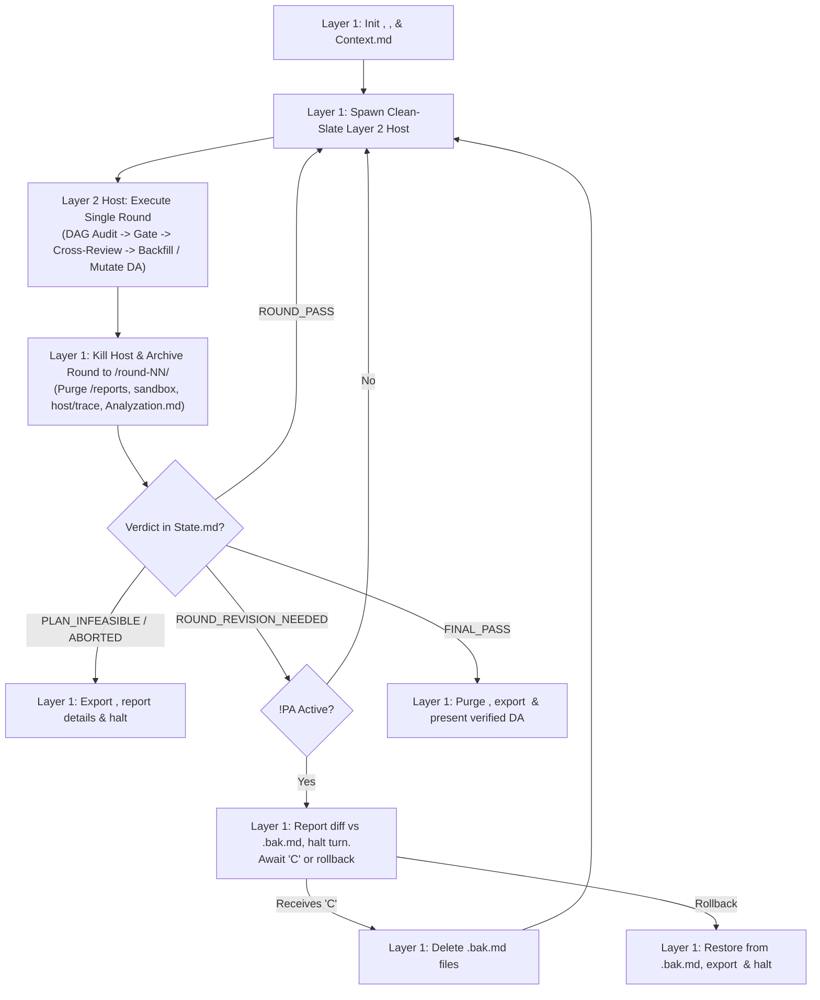

# Conduct Deep Reviewing Loop With Cross-Review

Multi-agent review loop using isolated clean-slate domain reviewers, topological dependency routing, independent gatekeeping, and cross-domain remediation review to verify Directive Artifacts (DA).

## Execution Architecture

| Layer | Agent | Primary Responsibility |
| :--- | :--- | :--- |
| **Layer 1** | Main Agent | Resolves `<short_title>`, binds `<review_dir>` (`.scratch/deep-review-<short_title>`) and external `<trace_vault>` (`/tmp/deep-review-trace-<short_title>`), initializes `Context.md`, spawns clean-slate Layer 2 Host per round, archives round artifacts to `<trace_vault>/round-<NN>/` after killing Host, manages `!PA` pause gate and rollbacks, and exports chronological trace on completion. |
| **Layer 2** | Review Host & Critical Gate | Ephemeral single-round orchestrator (`REVIEW-HOST-GUIDE.md`) and gatekeeper (`HOW-TO-GATE.md`). Selects active roster in Round 1, executes 4-tier DAG routing, enforces Tier Batch Gate and Intra-Tier Conflict resolution, runs Cross-Domain Remediation Review, preserves intra-round negotiation artifacts in `<review_dir>/host/trace/`, backfills skipped roles, mutates target DA(s) in-place, and writes `host/State.md` and `host/Analyzation.md`. |
| **Layer 3** | Domain Reviewers | Ephemeral clean-slate specialist subagents (up to 12 roles across 4 Tiers) executing domain audits per `<Role>-REVIEWER-GUIDE.md`, or summoned as fresh single-turn Cross-Reviewers to validate sibling role remediations. |

## Workflow



### Step 1: Initialize Workspace & Trace Vault [FOR LAYER 1 ONLY]

1. **Resolve `<short_title>`, `<review_dir>`, and `<trace_vault>`**:
   - Determine `<Topic>` by strict precedence:
     1. **Explicit User Specification**: Title/slug in prompt (excluding role names, modifier tags, and file paths).
     2. **Single Target DA Topic / Stem**: If filename stem is generic (`implementation_plan`, `plan`, `spec`, `draft`, `index`) or inside `.gemini/antigravity/brain/<id>/`, extract top-level H1 header text and strip leading prefixes matching `^(?:Implementation\s+Plan|Plan|Spec(?:ification)?|Design\s+Doc(?:ument)?|Architecture\s+Spec(?:ification)?)\s*[:–—|-]\s*`. Fallback to filename stem if no H1 exists.
     3. **Cluster / Epic Topic**: Common parent folder name or 2–3 word topic slug when auditing multiple DAs.
   - **Slugification Pipeline**:
     1. Convert whitespace, underscores (`_`), and non-alphanumeric characters to hyphens (`-`).
     2. Convert to lowercase and collapse consecutive hyphens (`-+` -> `-`).
     3. Truncate to maximum 25 characters and trim leading/trailing hyphens.
     4. If empty, fallback to `default`. MUST NOT contain `#`.
   - Bind `<review_dir>` = `.scratch/deep-review-<short_title>`. Never fallback to plain `.scratch/deep-review/`.
   - Bind `<trace_vault>` = `/tmp/deep-review-trace-<short_title>` (physically outside `<repo-root>` during active rounds so subagent `grep_search`, `find_by_name`, and `list_dir` calls inside `<repo-root>` cannot leak prior rounds).

2. **Directory & Trace Vault Initialization**:
   - Create or purge `<repo-root>/<review_dir>/host/`, `<repo-root>/<review_dir>/host/trace/`, `<repo-root>/<review_dir>/reports/`, and `<repo-root>/<review_dir>/sandbox/`.
   - Create or purge `/tmp/deep-review-trace-<short_title>/00-initial-context/da-initial/` and copy unmutated target DA(s) into `da-initial/`.
   - Delete any pre-existing sibling `<da_stem>.bak.md` files for target DAs.
   - Author `<repo-root>/<review_dir>/Context.md` containing:
     - `## Review Workspace: <review_dir>`
     - Target DA path(s) and `## Cross-Referenced DAs & Dependency Lineage` (`Upstream` | `Downstream`, `Implemented` | `Unimplemented`, and contract boundary).
     - `## Data Storage & Migration Scope`: Inspect target DAs and codebase for persistence markers (`migrations/`, `*.sql`, ORM models, `sqlite3`, `IndexedDB`, `localStorage`, `powersync`, `yjs`). Declare `Persistence Status: TOUCHES_PERSISTENCE` (with `Storage Archetype`: `Local-Side Storage` | `Server-Side Storage` | `Hybrid / Sync-Driven`, `Underlying Technology / Engine`, and `Target Seams & Files`) or `Persistence Status: NO_PERSISTENCE` with justification.
     - `## Data Science & ML Modeling Scope`: Inspect target DAs and codebase for data science, statistical modeling, or machine learning markers (feature engineering, cross-validation splits, tabular/deep learning models, custom loss functions, evaluation metrics, embeddings, ensembling, or PyTorch/Scikit-Learn/GBDT/JAX/TensorFlow pipelines). Declare `ML Status: TOUCHES_DATA_SCIENCE` (with `Modeling Archetype`, `Validation Split Topology`, `Target Metrics & Loss`, and `Feature / Inference Seams`) or `ML Status: NO_DATA_SCIENCE` with justification.
     - `## Observability Scope & Monitoring Archetype`: Inspect for logging, crash reporting, CLI flags, RUM, health probes, tracing, metrics, or feature flags. Declare `Observability Status: TOUCHES_OBSERVABILITY` (with `Primary Archetype`: `Client-Side / Desktop Application` | `CLI / Developer Utility` | `Frontend Web / Mobile RUM` | `Server-Side / Cloud Microservice` | `Library / SDK / Reusable Package` | `Multi-Tier / Hybrid Application`, `Diagnostic Sinks`, `Crash Capture & Boundaries`, `Privacy & Consent Constraints`) or `Observability Status: NO_OBSERVABILITY` with justification.
     - `## Security Scope & Threat Model Tier`: Inspect for authn/authz, tokens, hashing, tenant isolation, ingress parsing, file uploads, SSRF, webhooks, IPC, shell execution, RLS, LLM/agent tool-calls, or secrets. Declare `Security Status: TOUCHES_SECURITY_BOUNDARY` (with `Primary Archetype`: `Client-Side / Local Application` | `Frontend Web / Browser Application` | `Server-Side / Multi-Tenant SaaS API` | `Database & Persistence Security` | `Library / SDK / Reusable Package` | `AI / LLM / Agentic System` | `Multi-Tier / Hybrid Application`, `Trust Boundaries`, `Ingress & Egress Vectors`, `Credential Exposure Surfaces`) or `Security Status: NO_SECURITY_BOUNDARY` with justification.
     - `## Operational Continuity`: Inspect invocation prompt for `!NC0` / `!NCI`, `!NC`, or user directive:
       - If `!NC0` or `!NCI` is present, or prompt explicitly specifies intermediate stepping stone / non-operational after epic: declare `Operational Continuity: NON_CONTINUOUS_INTERMEDIATE` with concise technical justification.
       - If `!NC` is present, or prompt/architecture explicitly specifies non-continuous/offline upgrades (e.g. offline refactors, single-instance local/desktop/CLI version upgrades where versions $N$ and $N+1$ do not run side-by-side, or isolated rewrite branches; must be operational after the epic and preserve data via sequential migration scripts when schemas evolve): declare `Operational Continuity: NON_CONTINUOUS_OPERATION` with concise technical justification.
       - Otherwise (live 24/7 continuous services requiring side-by-side $N$ & $N+1$ zero-downtime rollout): declare `Operational Continuity: CONTINUOUS_OPERATION` (default).
     - `## UX/UI & Accessibility Regime`: Inspect invocation prompt (`!A11Y` / `!WCAG`, `!MOBILE` / `!RESPONSIVE`), target DA scope, and product/platform archetype to declare BOTH `UX/UI Regime` and `Form Factor`:
       - **`UX/UI Regime`**:
         - If `!A11Y` or `!WCAG` is present, or prompt/architecture explicitly targets an ADA/EAA/Section 508/WCAG-mandated product (e.g. Enterprise B2B SaaS, Public-Sector/GovTech, FinTech/Banking, Healthcare, Education, public E-Commerce storefront, or shared UI Component Library / Design System): declare `UX/UI Regime: STRICT_ACCESSIBILITY_COMPLIANCE` with concise technical justification (routes `UXUI` to `UX-STRICT-ACCESSIBILITY-WCAG.md`).
         - Otherwise (local/desktop apps, game launchers/save editors, community/indie tools, developer utilities, internal dashboards, or products without statutory disability compliance mandates): declare `UX/UI Regime: PRAGMATIC_PRODUCT_UX` (default; routes `UXUI` exclusively to `UX-PRAGMATIC-INTERACTION-DX.md`).
       - **`Form Factor`**:
         - If `!MOBILE` or `!RESPONSIVE` is present, or codebase/DA targets mobile/tablet/multi-screen web browsers or PWAs: declare `Form Factor: CROSS_DEVICE_RESPONSIVE` with concise technical justification (routes `UXUI` to `UX-MOBILE-RESPONSIVE-PERFORMANCE.md`).
         - Otherwise (Electron, Tauri, native desktop GUI, or desktop-only web tools/launchers/IDEs with fine pointer mouse/trackpad and bounded window dimensions): declare `Form Factor: DESKTOP_ONLY` (default for desktop apps; routes `UXUI` exclusively to `UX-DESKTOP-LAYOUT-PERFORMANCE.md`).
     - `## Active Modifiers` (e.g. `!PA`, `!SP<N>`, `!NC`, `!A11Y`, `!MOBILE`), codebase rules (`AGENTS.md`), task domain skills, user criteria, and static `SP` threshold.
   - Copy `<repo-root>/<review_dir>/Context.md` to `/tmp/deep-review-trace-<short_title>/00-initial-context/Context.md`.

### Step 2: Spawn Review Host & Critical Gate (Layer 2)

#### 2A. Define Host Subagent Type
If `review_host` is not registered in the active session, call `define_subagent`:
- `name`: `"review_host"`
- `description`: `"Host and Critical Gate for multi-agent deep reviewing loop"`
- `enable_subagent_tools: true`, `enable_write_tools: true`, `enable_mcp_tools: true`
- `system_prompt`: Reference `REVIEW-HOST-GUIDE.md` and `HOW-TO-GATE.md`.

#### 2B. Invoke Review Host
Call `invoke_subagent` with `TypeName: "review_host"`, `Role: "Review Host & Critical Gate"`, and exact `Prompt`:
- **Round 1**:
  `You are Review Host & Critical Gate. Review Workspace: <review_dir>. Target DA(s): <da_path(s)>. System Rules: AGENTS.md. Execution Protocol: REVIEW-HOST-GUIDE.md. Gating Standards: HOW-TO-GATE.md. Context: <review_dir>/Context.md. FIRST read the listed files, then execute review round per guides. If your context is compacted during execution: Upon receiving resuming command, check your progress by checking subagents, reports and host files and resume if unfinished, conclude and report if finished. DO NOT create a new round. Re-read REVIEW-HOST-GUIDE.md and HOW-TO-GATE.md.`
- **Round N+1**:
  `You are Review Host & Critical Gate. Review Workspace: <review_dir>. Target DA(s): <da_path(s)>. System Rules: AGENTS.md. Execution Protocol: REVIEW-HOST-GUIDE.md. Gating Standards: HOW-TO-GATE.md. Context: <review_dir>/Context.md. State: <review_dir>/host/State.md. FIRST read the listed files, then execute review round per guides. If your context is compacted during execution: Upon receiving resuming command, check your progress by checking subagents, reports and host files and resume if unfinished, conclude and report if finished. DO NOT create a new round. Re-read REVIEW-HOST-GUIDE.md and HOW-TO-GATE.md.`

### Step 3: Archive Round Trace & Handle Host Verdict [FOR LAYER 1 ONLY]

#### 3A. Mandatory Post-Round Teardown & Chronological Trace Archival
Immediately upon receiving completion from `review_host` for Round $N$:
1. Read `<review_dir>/host/Analyzation.md` and `<review_dir>/host/State.md`.
2. Terminate `review_host` via `manage_subagents(Action="kill")` (cascading termination to all Layer 3 subagents).
3. Archive Round $N$ into `/tmp/deep-review-trace-<short_title>/round-<NN>/`:
   Run the bundled archival script (atomically snapshots target DAs, moves reports/trace/sandbox, preserves pre-mutation `.bak.md` in `da-pre-mutation/`, respects `!PA` retention, and purges `host/Analyzation.md`):
   ```bash
   pwsh productivity/conduct-deep-reviewing-loop-with-cross-review/scripts/archive-round.ps1 -ReviewDir <review_dir> -Target <target_da_or_dir> -Round <N> [-Pause]
   # Or cross-platform Node.js:
   node productivity/conduct-deep-reviewing-loop-with-cross-review/scripts/archive-round.mjs --review-dir <review_dir> --target <target_da_or_dir> --round <N> [--pause]
   ```

#### 3B. Verdict Routing Table

| Verdict in `State.md` | Layer 1 Action (After Step 3A Archival) |
| :--- | :--- |
| `ROUND_REVISION_NEEDED` | • If Host updated `Context.md` for WBS restructuring, re-read `<review_dir>/Context.md` to bind active DA paths.<br>• **If `!PA` / `!WA` active**: Retain `<da_stem>.bak.md` backups on disk, output quota pause message, halt turn, and await `"C"` or rollback (see **Pause Gate Protocol**).<br>• **If no pause tag**: Immediately spawn a fresh Layer 2 Host for Round $N+1$ per Step 2B. |
| `ROUND_PASS` | Immediately spawn a fresh Layer 2 Host for the next Full Sweep round on the unchanged DA per Step 2B. |
| `FINAL_PASS` | Copy verified target DA(s) to `/tmp/deep-review-trace-<short_title>/final-verified-da/`. Purge `<repo-root>/<review_dir>/*`. Present verified DA(s) and report trace vault path `/tmp/deep-review-trace-<short_title>/` to user. |
| `PLAN_INFEASIBLE` | Purge `<repo-root>/<review_dir>/*`. Present `Technical Impasse Analysis` and `Alternative Architectural Paths` from archived `Analyzation.md` along with trace vault path `/tmp/deep-review-trace-<short_title>/`, and halt loop. |
| `ABORTED_MUTATION_FAILURE` | Purge `<repo-root>/<review_dir>/*`. Report filesystem failure details from archived `Analyzation.md` along with trace vault path `/tmp/deep-review-trace-<short_title>/`, and halt loop. |

#### 3C. Pause Gate Protocol (`!PA` / `!WA`) [FOR LAYER 1 ONLY]
When `ROUND_REVISION_NEEDED` occurs under `!PA` / `!WA`:
- Output message:
  `> "Paused per !PA request. Verified mutations were applied directly to target DA(s). Round trace archived to /tmp/deep-review-trace-<short_title>/round-<NN>/. Please check API quota or inspect diff against <da_stem>.bak.md. Send 'C' to remove backup files and proceed to Round {N+1}, or request rollback to revert mutations and halt."`
- **Upon receiving `"C"`**:
  1. If `<review_dir>/Context.bak.md` exists: delete sibling `<da_stem>.bak.md` files for any deleted DAs, and delete `<review_dir>/Context.bak.md`.
  2. Delete sibling `<da_stem>.bak.md` files for all active target DAs in `Context.md` and any orphaned `.bak.md` files.
  3. Spawn fresh Layer 2 Host for Round $N+1$ per Step 2B.
- **Upon user rollback command**:
  1. If `<review_dir>/Context.bak.md` exists: delete newly created DAs, restore `<review_dir>/Context.md` from `Context.bak.md`, and delete `Context.bak.md`.
  2. Restore every target DA in `Context.md` from its sibling `<da_stem>.bak.md` and delete all `.bak.md` files.
  3. Purge `<repo-root>/<review_dir>/*`, report that mutations were reverted, provide trace vault path `/tmp/deep-review-trace-<short_title>/`, and halt loop.
- **Upon request to remove `!PA` / run continuously**:
  1. Remove `!PA` / `!WA` from `## Active Modifiers` in `<review_dir>/Context.md`.
  2. Clean up all `.bak.md` files (same as receiving `"C"`) and autonomously drive subsequent rounds via Step 2B.

## Modifiers

| Command | Action |
| :--- | :--- |
| `!SP<N>` | Set required continuous Full Sweep PASS rounds threshold to `N` (Default: `1`). |
| `!PA` / `!WA` | Pre-review pause gate: retains `<da_stem>.bak.md` on `ROUND_REVISION_NEEDED` and halts turn awaiting `"C"` or rollback. |
| `!NC` | Set operational continuity to `NON_CONTINUOUS_OPERATION` (offline upgrades/refactors, local/desktop apps, isolated rewrite branches; must be operational after the epic and migrate existing data via sequential migration scripts without 24/7 dual-write shims). Default is `CONTINUOUS_OPERATION`. |
| `!NC0` / `!NCI` | Set operational continuity to `NON_CONTINUOUS_INTERMEDIATE` (intermediate stepping stone / scaffolding; does not need to operate during OR after this epic). |
| `!A11Y` / `!WCAG` | Set UX/UI regime to `STRICT_ACCESSIBILITY_COMPLIANCE` (loads `UX-STRICT-ACCESSIBILITY-WCAG.md`). Default is `PRAGMATIC_PRODUCT_UX` (`UX-PRAGMATIC-INTERACTION-DX.md`). |
| `!MOBILE` / `!RESPONSIVE` | Set UX/UI form factor to `CROSS_DEVICE_RESPONSIVE` (loads `UX-MOBILE-RESPONSIVE-PERFORMANCE.md`). Default for desktop/Electron/Tauri apps is `DESKTOP_ONLY` (`UX-DESKTOP-LAYOUT-PERFORMANCE.md`). |
| `!FPA` | Instantly kill running subagents and pause execution. |
