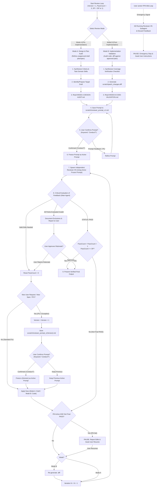

# Conduct Reviewing Loop

Run iterative, independent subagent reviews to stress-test plans (pre-implementation) or validate codebase diffs against approved specifications (post-implementation) against explicit user and system criteria.

## Dual-Mode Architecture & Workflows

### 1. Mode Selection & Review Matrix

| Mode | Target Artifacts | Primary Goal | Reviewer Action | Termination Condition |
| :--- | :--- | :--- | :--- | :--- |
| **Mode A: Design & Plan Audit** *(Pre-Implementation)* | Draft `implementation_plan.md`, PRD, Skill RFC | Discover architectural gaps, edge cases, and design flaws before coding | Output numbered edits to the **draft document** | `Final PASS` ($\text{PassCount} = \text{SP}$) or User-Approved Invalid Rationale |
| **Mode B: Implementation Validation** *(Post-Implementation)* | Approved Plan + `.diff` Artifact + Modified Code/Tests | Verify 100% plan coverage, zero regressions, and full spec compliance | Output numbered missing plan items or defects in the **codebase** | `Final PASS` ($\text{PassCount} = \text{SP}$) or User-Approved Invalid Rationale |

### 2. Reviewer Loop Protocol (Blind Protocol & Approval Gate)

> [!IMPORTANT]
> **Prompt Persistence & Approval Gate Protocol**:
> 1. **Synthesize Task Domain Skills & Read Templates**: Read `MODE-A-DESIGN-AUDIT.md` (Mode A) or `MODE-B-CODE-VALIDATION.md` (Mode B) using your native file-reading tool. Under `Required Reading` in the synthesized reviewer prompt, include 1-2 matching `<Role>-REVIEWER-GUIDE.md` files from `../conduct-deep-reviewing-loop/` (Mode A, with output/workspace override) or `<skill_dir>/REVIEWER-CODE-VALIDATION.md` + `<skill_dir>/REVIEWER-ANTI-LAZINESS.md` (Mode B), alongside task domain skills. NEVER pass `SKILL.md`, `MODE-A-DESIGN-AUDIT.md`, or `MODE-B-CODE-VALIDATION.md` to Subagents.
> 2. **Save Prompt & `.diff`**: Save every reviewer prompt to `<scratch_dir>/reviewer_prompt_v<Version>.md`. In Mode B, generate `<scratch_dir>/patch_changes.diff` per `MODE-B-CODE-VALIDATION.md` §3 and re-generate it after each fix round (keeping the approved plan immutable).
> 3. **Initial User Approval Gate (Disambiguated)**: Present `<scratch_dir>/reviewer_prompt_v1.md` to the user and **AWAIT EXPLICIT KEYWORD "Conduct?"** (or *"Conduct review"*) before spawning Reviewer #1. *Do NOT ask using "Approve" or "Proceed" for prompt authorization to prevent lower-tier models from confusing prompt confirmation with direct Tier 3 plan/source approval.*
> 4. **Immutable Active Prompt Reuse**: Freeze the approved prompt as Active Prompt ($P_{active}$) and reuse it 100% identically for subsequent reviewers (#2, #3... #N), changing only the Reviewer ID.
> 5. **Prompt Revision Exception (v1 $\rightarrow$ vN)**: Prompt updates (`reviewer_prompt_v<Version>.md`) are permitted ONLY if triggered by `!PU`, explicit user instructions, a newly discovered High-Level Specification, or user-approved exclusions/non-goals (Mode B), all requiring user confirmation (*"Conduct?"*).
> 6. **Preventing Blind Reviewer Deadlocks**: Record user-approved rejected suggestions under **Out-of-Scope / Non-Goals** in the draft (Mode A) or in `reviewer_prompt_v<Version>.md` (Mode B) so subsequent blind reviewers do not re-raise them.
> 7. **Clean & Neutral Artifact Rule (Anti-Anchoring)**: Integrate Mode A draft updates seamlessly as native specifications without past reviewer references, reviewer-based version tags, or meta-changelogs.

> [!WARNING]
> **Critical Evaluation & Non-Blocking Churn Guard (Main Agent Gatekeeper)**: Evaluate reviewer feedback critically against YAGNI, empirical codebase facts, and repository rules (`AGENTS.md`).
> - **Non-Blocking Churn Guard**: Items listed under `Suggestions for Improvement (Optional / Non-blocking)` do NOT affect `STATUS: PASS`. The Main Agent **MUST NOT** edit the draft plan, modify codebase files, or reset `PassCount` based on non-blocking suggestions unless the user explicitly commands it.

## Subdoc References

- **Main Agent Orchestration Guides**: [MODE-A-DESIGN-AUDIT.md](MODE-A-DESIGN-AUDIT.md) (Mode A), [MODE-B-CODE-VALIDATION.md](MODE-B-CODE-VALIDATION.md) (Mode B).
- **Subagent Reviewer Rubrics**: Mode A uses 1-2 matching `<Role>-REVIEWER-GUIDE.md` files from `../conduct-deep-reviewing-loop/`; Mode B uses [REVIEWER-CODE-VALIDATION.md](REVIEWER-CODE-VALIDATION.md) and [REVIEWER-ANTI-LAZINESS.md](REVIEWER-ANTI-LAZINESS.md).

## Domain Terms and Modifiers

- **`PassCount`**: Consecutive `STATUS: PASS` evaluations; resets to `0` on `STATUS: REVISIONS NEEDED`. `Final PASS` completes the loop when $\text{PassCount} = \text{SP}$.
- **`Active Prompt`**: The frozen, user-approved prompt file (`<scratch_dir>/reviewer_prompt_v<Version>.md`) reused identically across blind reviewers.

| Modifier | Timing | Action |
| :--- | :--- | :--- |
| `!SP<N>` | Start-time | Sets continuous `PASS` threshold `SP = N` (default: `1`). |
| `!PU [Instructions]` | Mid-flight | Increments prompt version, writes `<scratch_dir>/reviewer_prompt_v<Version+1>.md`, awaits `"Conduct?"`, and freezes it as Active Prompt. |
| `!PA` | Mid-flight | Pauses after applying valid fixes, reports edit summary, and awaits user resume before Reviewer #N+1 (skipped on `Final PASS`). |
| `!FPA` | Mid-flight | Terminates the active reviewer subagent immediately, discards pending feedback, prevents edits, and pauses awaiting user instructions. |
