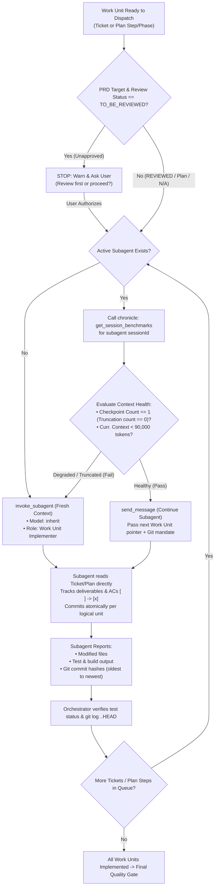

# Implement With Subagents

Execute multi-ticket PRDs or multi-step implementation plans sequentially via subagents, monitoring context health with `chronicle` and isolating specification files from orchestrator prompts.

## Core Principles

1. **Zero Specs in Prompt (No Prompt Telephone Game)**: NEVER summarize, paraphrase, or re-explain requirements or acceptance criteria in the orchestrator prompt. Include ONLY target artifact pointers (ticket/plan path and step/phase scope if applicable), git directives (branch, atomic commit format, final `closes #XX` if issue-backed), and verification commands; subagents MUST read specs directly from disk.
2. **Sequential Work-Unit Execution**: Dispatch one ticket or plan step/phase at a time for clean atomic commit history and conflict-free testing.
3. **Data-Driven Context Lifecycle**: Before assigning another work unit to an existing subagent, inspect its context health via `chronicle:get_session_benchmarks` rather than guessing truncation or saturation.
4. **Pre-Dispatch Review Gate**: Before dispatching any ticket from a PRD, read `Review Status` in `PRD.md`. If `TO_BE_REVIEWED` (and unreviewed execution was not explicitly authorized), STOP and ask the user whether to review the PRD first or proceed anyway.

## Workflow



### 1. Formulate Dispatch Prompt

When calling `invoke_subagent` or `send_message`, pass only artifact pointers and execution commands:

```markdown
Implement Work Unit: <Ticket-or-Plan-Step-Title>
- Target Artifact: <path-to-ticket-or-plan.md> (Scope: <entire ticket | Phase/Step X>; Issue #<ID> if applicable)
- Parent Spec / PRD: <path-to-prd-or-spec.md or N/A>

Directives:
1. Work on branch: `<branch-name>`.
2. Execution Mandate:
   - Read Target Artifact (and Parent Spec / `PRD.md` when present, specifically `Review Status`, `Change Mode`, `Reviewed-At-Commit`, and `## Intentional Deltas`) directly from disk. Do not assume or guess specifications.
   - Pre-flight spec drift, unasked-change guard & considerate porting: Resolve baseline commit from `Reviewed-At-Commit` in the Parent Spec, Target Ticket, or Plan header, falling back to `git log -n 1 --format=%H -- <target-path-or-spec-dir>` if missing; when a SHA is found, run `git log --oneline <sha>..HEAD -- <touched-paths>` before editing (if untracked/empty, verify touched files and symbols directly on disk), inspect overlapping commits, and reconcile live defaults, protocols, or handlers instead of overwriting newer live behavior (report semantic contradictions to the orchestrator before coding). Implement only what is explicitly specified; do NOT alter, restyle, or remove unasked behaviors. When modifying, migrating, or replacing an existing file/component (including `[NEW]` deliverables declaring `Replaces: <legacy-file-path(s)>`), read the live legacy implementation and paired assets/stylesheets/tests first; underlying implementation layers may change per ticket or plan, while all existing observable behavior, contracts, and `initial intended UXUI` default to **PRESERVE** unless explicitly listed under `INTENTIONALLY_CHANGED` in `PRD.md` or specified in the plan.
   - Zero Duplicate Planning: Do NOT create a duplicate `implementation_plan.md`. Use the Target Artifact itself as your live plan.
   - Autonomous execution: Start implementation immediately. Do NOT ask for user confirmation or briefing approval.
   - Pre-flight checkboxing: Before coding, if the deliverables/steps under `## What to Build` or `## Proposed Changes` in the Target Artifact (e.g. `### 1. <Deliverable>`) lack GFM task-list checkboxes (`- [ ]`), convert each deliverable/step header to `- [ ] 1. **<Deliverable>**`.
   - Two-layer TDD progression: Advance assigned deliverables/steps sequentially without intermediate `[/]` edits (`[ ]` -> `[x]` only after verification). For each deliverable/step, write/update tests alongside code, run verification, then mark the item `[x]` and simultaneously mark `[x]` on the `## Acceptance Criteria` / `## Verification Plan` items proven by those tests. When toggling checkboxes, patch ONLY the minimal unique prefix (or scoped line range) instead of echoing entire lines or paragraphs. Verify and mark `[x]` on any remaining cross-cutting `## Acceptance Criteria` / `## Verification Plan` items before the final commit.
   - Scope isolation: Focus strictly on this assigned work unit. Do NOT inspect, query, or implement other tickets or unscheduled plan phases.
   - Use the configured repository file-edit tool (e.g. MCP `patchitright`) for code edits.
   - Run verification commands: `<test-command>` and `<build-command>`.
   - Atomic Conventional Commits: Commit each verified logical change atomically as `<type>(<scope>): <summary>` rather than bundling unrelated refactor/feature/test work into one commit. If backed by a GitHub issue (`#<ID>`), attach ` (closes #<ID>)` ONLY on the final commit completing all acceptance criteria (never on intermediate commits). Push if requested.
3. Report back with:
   - List of modified/created files
   - Test execution logs proving 100% pass rate
   - Git commit hashes (oldest to newest)
```

### 2. Evaluate Subagent Health (`chronicle:get_session_benchmarks`)

Before sending a follow-up work unit to an existing subagent, call `chronicle:get_session_benchmarks` with `{"sessionIds": ["<subagent-conversation-id>"]}`:

| Chronicle Metric Condition | Action |
| :--- | :--- |
| `Truncation Count` (`Checkpoint Count - 1`) `> 0` | **SPAWN NEW**: Context was truncated/compressed and precision is degraded. |
| `Curr. Context >= 90,000` tokens | **SPAWN NEW**: Near capacity; risks mid-turn truncation on next work unit. |
| `Checkpoint Count == 1` AND `Curr. Context < 90,000` | **REUSE SUBAGENT**: Healthy reasoning history and token headroom. |

If `chronicle:get_session_benchmarks` is unavailable in the active runtime, default to **SPAWN NEW** for every work unit rather than guessing context headroom.

After each subagent reports done, verify tests and the commit range (`git log <base>..HEAD`) on the target branch before dispatching the next work unit.
