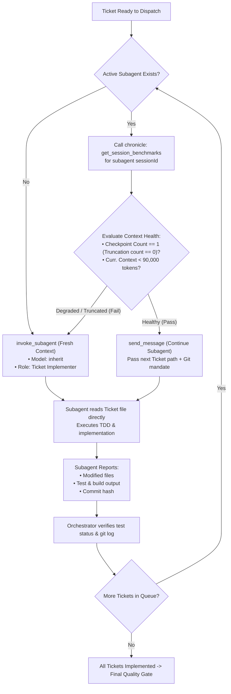

# Implement With Subagents

Execute multi-ticket or multi-step work sequentially via subagents, monitoring context health with `chronicle` and isolating specification files from orchestrator prompts.

## Core Principles

1. **Zero Specs in Prompt (No Prompt Telephone Game)**: NEVER summarize, paraphrase, or re-explain requirements or acceptance criteria in the orchestrator prompt. Include ONLY the target ticket/spec path, git directives (branch, commit format, `closes #XX`), and verification commands; subagents MUST read specs directly from disk.
2. **Sequential Ticket Execution**: Dispatch one ticket at a time for atomic commits, clean history, and conflict-free testing.
3. **Data-Driven Context Lifecycle**: Before assigning another ticket to an existing subagent, inspect its context health via `chronicle:get_session_benchmarks` rather than guessing truncation or saturation.

## Workflow



### 1. Formulate Dispatch Prompt

When calling `invoke_subagent` or `send_message`, pass only artifact pointers and execution commands:

```markdown
Implement Ticket: <Ticket-Title>
- Target Ticket: <path-to-ticket-file.md> (Issue #<ID>)
- Parent Spec / PRD: <path-to-prd-or-spec.md>

Directives:
1. Work on branch: `<branch-name>`.
2. Execution Mandate:
   - Read the Target Ticket and Parent Spec files directly from disk. Do not assume or guess specifications.
   - Follow `implement-a-ticket` / `tdd` workflows.
   - Use the configured repository file-edit tool (e.g. MCP `patchitright`) for code edits.
   - Run verification commands: `<test-command>` and `<build-command>`.
   - Git commit & push: `<type>(<scope>): <summary> (closes #<ID>)`.
3. Report back with:
   - List of modified/created files
   - Test execution logs proving 100% pass rate
   - Git commit hash
```

### 2. Evaluate Subagent Health (`chronicle:get_session_benchmarks`)

Before sending a follow-up ticket to an existing subagent, call `chronicle:get_session_benchmarks` with `{"sessionIds": ["<subagent-conversation-id>"]}`:

| Chronicle Metric Condition | Action |
| :--- | :--- |
| `Truncation Count` (`Checkpoint Count - 1`) `> 0` | **SPAWN NEW**: Context was truncated/compressed and precision is degraded. |
| `Curr. Context >= 90,000` tokens | **SPAWN NEW**: Near capacity; risks mid-turn truncation on next ticket. |
| `Checkpoint Count == 1` AND `Curr. Context < 90,000` | **REUSE SUBAGENT**: Healthy reasoning history and token headroom. |

After each subagent reports done, verify tests and the commit on the target branch before dispatching the next ticket.
