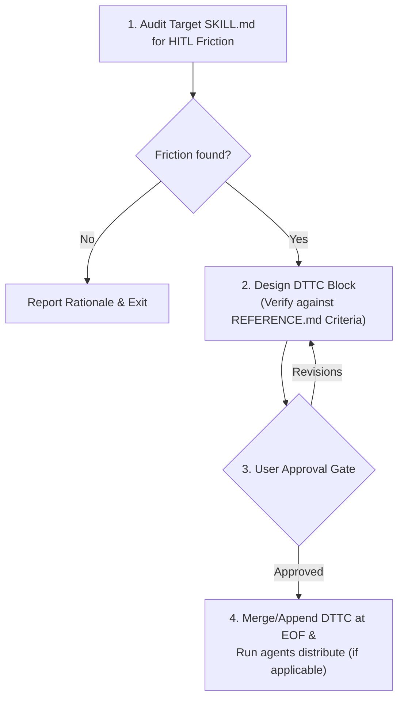

# Write Skill DTTC

Audit human-in-the-loop (HITL) interaction points in skill workflows and append standardized Domain Terms and Tag Commands (DTTC) to the bottom of target `SKILL.md`. For tag worthiness criteria and anti-patterns, see [REFERENCE.md](REFERENCE.md).

## Directives

1. **Tag Worthiness**: MUST verify every candidate tag against the Tag Worthiness Criteria in [REFERENCE.md](REFERENCE.md). Reject low-savings, one-off, or protocol-mutating tags.
2. **Syntax & Parsing**:
   - MUST use `!<TAG><ARG>` (2-3 uppercase letters, e.g., `!SP<N>`, `!PU [Text]`, `!PA`) with a sensible default value.
   - Tag handling MUST be case-insensitive (`!sp2` matches `!SP2`).
3. **Placement & Idempotency**:
   - DTTC section MUST be placed at the very bottom (EOF) of target `SKILL.md`.
   - If a DTTC section already exists, merge new tags and move the section to EOF.
4. **Approval Gate**: NEVER modify target `SKILL.md` before presenting the proposed DTTC block and obtaining explicit user approval.

## Failure Modes & Recovery

| Condition | Action |
| :--- | :--- |
| No typing friction, rigid thresholds, or missing mid-flight controls found | Report rationale and exit without editing files. |
| Candidate tag collides with an existing `!<TAG>` in target `SKILL.md` | Rename the new tag or merge behavior after user confirmation; NEVER silently overwrite an existing tag. |
| `agents distribute` is unavailable or fails | Skip distribution if outside an `agents`-managed repo; on failure, report the error and inspect target paths. |

## Workflow



## Template (`SKILL.md` Bottom Section)

```markdown
## Domain Terms and Tag Commands

- **`<DOMAIN_TERM>`**: <Concise definition of the shared concept>.
- **`!<TAG><ARG>` (<Full Name>)**: <Primary purpose> (Default: `<default_value>`; Timing: `Start-time | Mid-flight`).
  - **Agent Action**: <Explicit step-by-step action taken upon receiving tag>.
```
