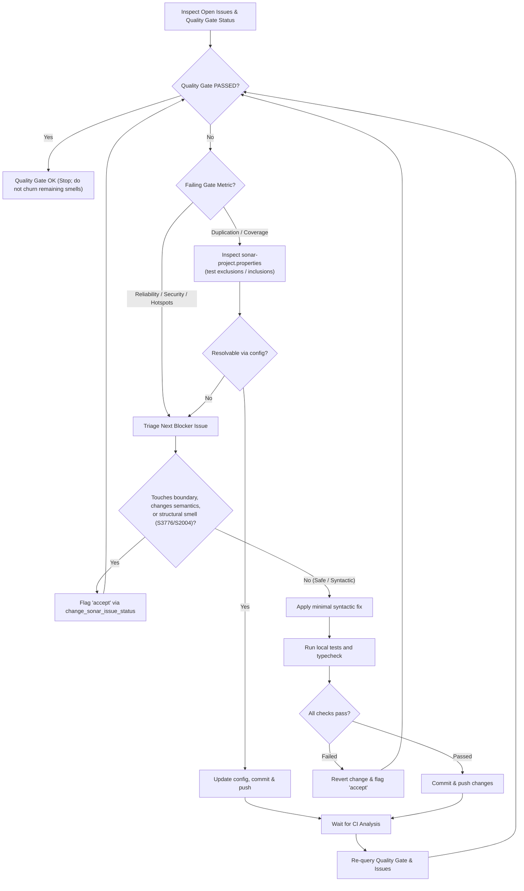

# Sonar Remediation & Quality Gate Workflows

Inspect, remediate, accept, and automate SonarQube/SonarCloud issues across files, PRs, or repositories (`sonarcloud:` and `sonarqube:` MCP servers). For rule cookbooks, MCP schemas, and code patterns, see [REFERENCE.md](REFERENCE.md).

## Directives

1. **Quality Gate Priority**: Exit once `Quality Gate === PASSED / OK`. NEVER destabilize working code or churn remaining smells after the Quality Gate passes.
2. **Test Invariance**: NEVER modify unit or integration tests to satisfy Sonar suggestions. If a fix breaks any test, immediately revert the failing edit and flag `"accept"` or `"falsepositive"`.
3. **Boundary Invariance**: NEVER refactor, extract functions, or alter serialization/cloning mechanics across sensitive boundaries (Transactions, Migrations, State stores, IPC channels, external configs); flag `"accept"` instead.
4. **Config Before Code**: For Duplication (CPD) or Coverage failures, inspect `sonar-project.properties` (e.g. `sonar.tests`, `sonar.cpd.exclusions`) before editing source code.
5. **Pure Syntactic Fixes Only**: Apply fixes ONLY when 100% syntactically safe (delete unused local variable/import, fix typo). If a fix requires behavioral changes or structural refactoring, flag `"accept"`.
6. **Signature & Entrypoint Preservation**: NEVER delete, rename, or move standalone entrypoints, child processes, worker scripts, dynamic IPC/service handlers, or public API signatures.
7. **Domain Contract Preservation (`S1854`, `S1481`)**: NEVER alter returned object keys or state properties to consume an unused variable; delete the dead variable calculation instead.
8. **Issue Verification Before Status Change**: Before calling `change_sonar_issue_status` (`"accept"` or `"falsepositive"`), MUST query the exact issue key via `search_sonar_issues` / `search_sonar_issues_in_projects` with `issueStatuses: ["OPEN"]`.
9. **PR Scope Parameter**: When analyzing an active PR, MUST pass `pullRequestId` or `pullRequest` (omitting it queries the default branch).

## Query Scope & Issue Triage

| Scope | MCP Query Call |
| :--- | :--- |
| **File** | `search_sonar_issues({ projectKey, componentKeys: ['<projectKey>:<filePath>'], issueStatuses: ['OPEN'] })` |
| **Commit** | `git show --name-only <hash>` -> `search_sonar_issues({ projectKey, componentKeys, inNewCodePeriod: true })` |
| **Pull Request (PR)** | `search_sonar_issues({ projectKey, pullRequest: '<pr_id>', issueStatuses: ['OPEN'] })` |
| **Branch** | `search_sonar_issues({ projectKey, branch: '<branch_name>', issueStatuses: ['OPEN'] })` |
| **Repository** | `search_sonar_issues({ projectKey, issueStatuses: ['OPEN'] })` |
| **File + PR** | `search_sonar_issues({ projectKey, pullRequest: '<pr_id>', componentKeys: ['<projectKey>:<filePath>'], issueStatuses: ['OPEN'] })` |

| Issue Category / Rules | Action & Constraints |
| :--- | :--- |
| **Cognitive Complexity (`S3776`)** | Flag `accept`. NEVER split functions solely for `S3776`; structural splits require `improve-codebase-architecture`. |
| **Deep Nesting (`S2004`)** | Flag `accept`. Deep nesting in UI/event/search closures is intentional design. |
| **Boundary Spreads & Cloning (`S7784`, `S7744`)** | Flag `accept`. Spreads `{ ...(x \|\| {}) }` guard boundaries; `structuredClone` throws on Proxies. Preserve runtime semantics. |
| **Bounded Path/File Regexes (`S8786`)** | Flag `accept`. Paths/filenames are OS-bounded and carry no practical ReDoS risk. |
| **Theme Contrast (`css:S7924`)** | Flag `accept`. Brand theme tokens override generic WCAG checks. |
| **Duplications (CPD)** | Inspect `sonar-project.properties` test exclusions first; consolidate production duplicates only if the gate still fails. |
| **Language Smells (`S1854`, `S1481`, etc.)** | Apply minimal syntactic fix following [REFERENCE.md](REFERENCE.md). |

## Verification Loop & Batch Scripts

For large backlogs, run scripts in `<skill-dir>/scripts/`:
- `count_issues.py`: Aggregate issues by rule and component.
- `generate_plan.py`: Generate remediation plan (`request_feedback: true`).
- `generate_task.py`: Generate atomic task files (`user_facing: true`).
